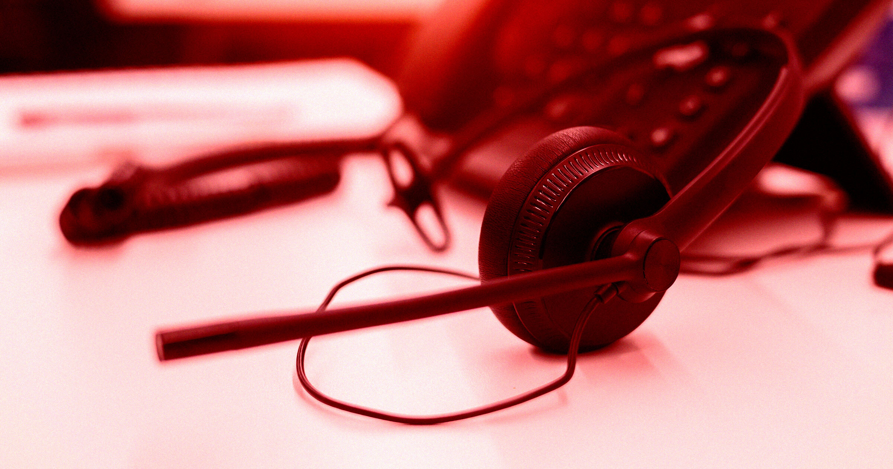

# 揭秘 Meta Muse AI 的惊天骯脏秘密

> Meta 宣称新 AI 代理 Muse 能代你打电话、预约餐厅，还能处理所有日常杂事——结果 404 Media 揭露，幕后竟有真人客服在接管这些通话，Meta 内部员工见状急得直跪求领导别公开上线这功能。

Meta 吹嘘 Muse AI 是多能"个人助理"，实际上很多通话是真人客服在处理。

## Muse 被描绘成全能生活助理：购物、邮箱、财务，样样都能搞

Meta 大肆宣扬它的新 AI 代理 Muse——一个能处理你生活里所有平淡无奇琐事的"全方位个人助理"。从网上购物，到管理邮件，再到盯着你的钱包——甚至还能替你挑衣服，反正你就是个邋遢的 slob。

上周，它还宣布了一项听起来在 AI 时代实际有点用的功能：替你给企业打电话。再也不用自己去预约、订餐、或者在电话树里循环等待了——Muse 帮你搞定。对于普通人来说，这可是挺实际的 AI 用例：打个电话通常意味着跟机器人对话，这项功能确实可以改善生活——如果它真的是 AI 的话。

## 幕后真人客服操控通话，Meta 员工哀求领导别发八

幕后有些通话其实是由人工呼叫中心的员工处理的——404 Media 报道了这事，而且这些员工几乎是哀求公司别真的这么做。

这又是 AI 行业老一套的戏码。他们的工具被包装成强大且自给自足的，但很多时候只是个幌子，下面由人——往往是低薪合同工，有时还在海外——在背后支持着。

目前尚不清楚有多少通话被路由给了真人，而且这个功能还处在"内部测试"（dogfooding）阶段。公司突然向员工宣布了这项功能，并称"为确保通话完成，增加了一层人类代理。"

## 内部通告全文曝光："Muse 不只拨号"

内部通告是这么写的（被 404 看到）："Muse 不只拨号。它替你给企业打电话，处理对话，完成请求，并汇报回一条 Transcript 和 summary。" "它也不再独狼行动。Muse 现在能把请求转交给训练过的人类代理，后者负责拨号并处理。"

"这仍是个保密的发布前产品，"通告继续说，"请不要把它或它产生的任何东西跟公司外的人分享。"

## Meta 员工集体炸锅："这绝对会引爆 PR"

员工们立刻对此产生怀疑——怕也有理。多数人担心，Meta 居然考虑过这个主意的想法本身就可能毁了 Muse 的形象，另一些人则提出了安全顾虑：把客户的私人请求在内部共享，会有泄露风险。

"不确定我错过了啥，但为啥这是一个'feature'？"一名员工在内部消息板里写道（据 404 报道），其怀疑很快被证明是先知般的。"这有可能导致大量负面 PR。我们可能会被 portrayed 成'他们的 AI 不够好所以还需要人类'这种新闻类型的 coverage 来报道这个发布。"

有的员工干脆绝望地在老板面前叩头求饶，乞求撤回这个决定。

## "如果我们默认开启发布，这肯定会制造巨量 outcry"

"如果我们默认开启发布，这肯定会杀死所有 goodwill 和有机 press——我们正从早期采用者那里得到这些，"另一位员工哀求道。

"请想想新闻标题会怎么尖叫：'Meta 用幕后人类完成通话'或'Muse AI 其实是独立承包商'，继而产生大量关于我们数据处理隐私和安全的坏宣传，"他们继续写道，伏地祈求的姿态越发绝望。"please PLEASE 别按原样发布，如果我们绝对必须发布，至少把它做成用户偏好 setting。Please。"

## Meta 回应：只是常规内部测试，但没排除上大众市场

在给 404 的声明里，Meta 把这个功能包装成常规内部测试的一部分，虽然没排除把它推向大众市场的可能性。

"虽然员工的反馈总体上是积极正面的，"一位发言人很郑重其事地说，"整个重点是获取反馈，这样我们就能在公开发布前落实安全和隐私保护措施、改进功能。"

"我们正跟商家合作，继续改进这个潜在的呼叫功能，"发言人补充道，"且只会在准备好并带有适当披露的情况下推出。"

---

**原文：** It Turns Out That Meta's Muse AI Has an Amazingly Dirty Secret
