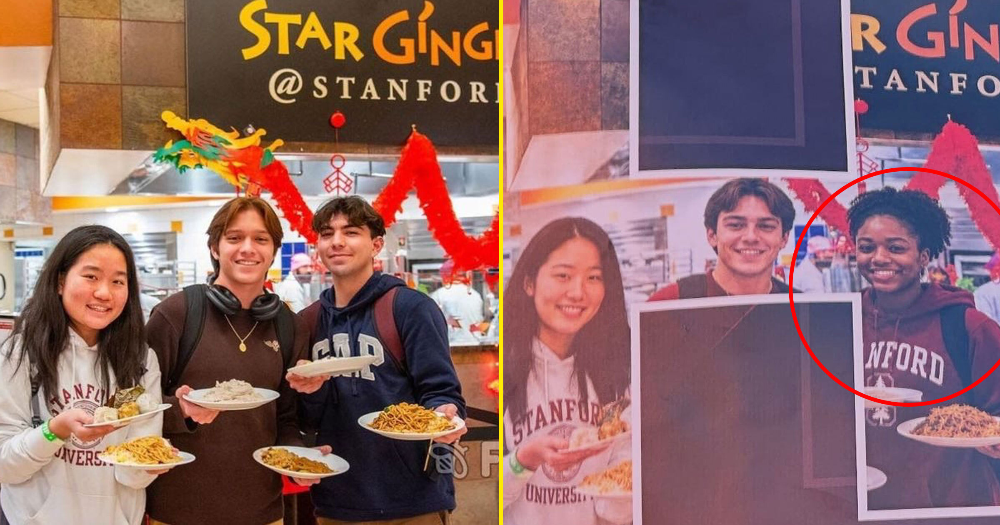

# 斯坦福用AI把学生P成"虚构黑人女性"贴满校园，被当场揭穿

> 斯坦福大学被曝用AI把照片里的一名真实学生替换成并不存在的黑人女性，再把这张改过的照片印成"Welcome Home"横幅挂遍校园，为学校食堂打广告。

斯坦福食堂宣传海报被曝用AI改图，把真实学生替换成虚构人物。

## "一开始觉得挺好笑，后来觉得被抹掉了"

据最先报道这起乌龙的学生报纸《斯坦福评论》，被从照片中P掉的当事人 Billy Ramirez 起初觉得这件事"挺搞笑"。但作为拉美裔学生，他很快就感到"被消音、被从一份本应包含我的呈现里抹除"。改动照片中另外两名学生——一名亚裔女生和一名白人男生——则被"美颜"得更瘦、更符合主流审美。

据《旧金山纪事报》报道，这张经过AI修饰的照片被用在校园各处的"Welcome Home"横幅上。Ramirez 说，这些海报一度"贴满整个校园"，如今正被撤下。"我爱这所学校，但我不喜欢他们做这种事。"

他补充说，塞进一个虚构的黑人学生并不"反映现实"，"这里远没有他们包装出来的那么多元"。

## 食堂海报的老毛病

《旧金山纪事报》发现，斯坦福的住宿与餐饮服务部门此前就曾用AI生成餐饮海报来促销不同套餐——那些纹理过度堆叠的食物，正是近来备受批评的"AI食物图"的典型破绽。

一名斯坦福发言人向该报证实，图片确实经过AI编辑，且违反了学校的AI政策。"使用AI生成或改动斯坦福的人物、活动、研究、设施或成就相关图像，是被严格禁止的，"发言人说，"本案中的改动以及未披露，都违反了这一政策。我们正着手为全体员工提供额外培训，并确保对所有材料进行适当审查。"

## 又是一次随手改写现实

这又是一个AI随手改写现实的案例——改完之后，除了是个谎言，成品往往还廉价、刺眼、一眼假。《斯坦福评论》的判断是，食堂方面"多半以为这些改动足够细微，没人会察觉"。

Ramirez 的语气里既疲惫又有点无奈。"这里是硅谷嘛，"他对《旧金山纪事报》说，"考虑到斯坦福的文化高度围绕AI展开，我没那么惊讶。"他还提到，自己的一些教授就经常使用 Anthropic 的 Claude 聊天机器人。
