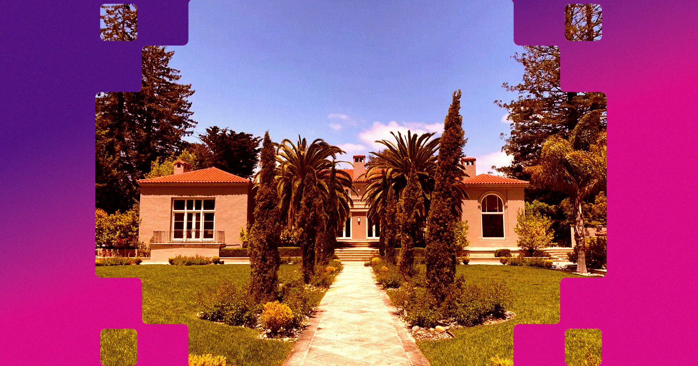

# 硅谷"黑客之家"被曝性侵文化：AGI House 四年记录37起警情

> 《纽约时报》调查揭露硅谷豪宅里的"黑客之家"滋生骚扰与强奸指控：位于 Hillsborough 的 AGI House 自2022年起被警方记录37起事件，一名女子凌晨从 Lyft 上报警称被困屋内。

硅谷一座座巨型豪宅里的"黑客之家"，正被曝出骚扰与性侵指控。

## 凌晨两点的报警电话

科技界未来的创业者们，正生活在硅谷那些巨大的豪宅里，与十几个甚至更多志同道合的人同住，日子基本上就是一场持续的派对。但这些所谓"黑客之家"（hacker house）有阴暗的一面。

《纽约时报》最近的一项调查挖出了多起源于黑客之家的骚扰案件和强奸指控。其中最显眼的是位于 Hillsborough 的 AGI House（AGI 即"通用人工智能"），警方自2022年以来在该地址记录了37起事件，至少17起与这里常年举办的大型奢华派对和活动有关。

去年12月，一名女子凌晨两点从一辆 Lyft 上打电话给 Hillsborough 警局，报告自己被 AGI House 的一名男性住户困住，对方试图强迫她发生性关系。据《纽约时报》查阅的警方报告，这名男子对她说，她年纪大了，"会永远孤独下去"，并"执意劝说"她"与他发生性关系，而她反复拒绝"。她翻过一道门逃了出来，没有受伤。

## NeoGenesis、Genesis 与一条延续的暗线

AGI House 由前 Google 研究员 Jeremy Nixon 创办，他还建过其他科技住宅。他对《纽约时报》说，自己的构想是"让20个 AI 黑客在同一栋史诗级房子里住上三个月"。这栋房子最初叫 NeoGenesis，在 OpenAI 发布 ChatGPT、点燃 AI 热潮后改了名。而在 NeoGenesis 之前，他还在2019年联合创办了一个叫 Genesis 的黑客之家。

Genesis 有自己的黑历史。它同样是派对中心，放荡不缺。一名19岁的科技创业者对《纽约时报》说，他13岁时就曾溜进这里的派对。"那真的挺疯狂的。"

30岁的 Yehong Zhu 在2021年12月报案，指控一名前 Genesis 住户强奸和袭击。Zhu 住过四栋科技住宅，这段经历击碎了她把这些地方视为创业者乌托邦的看法。她说，案件仍在调查中，被指控的那名前 Genesis 住户没有搬走，也找不到人。"遭遇这件事的远不止我一个。"她告诉《纽约时报》。她创办了自己的初创公司 Zette AI。

## 谁在为这套文化背书

需要说明的是，这些黑客之家并不是随机的聚会场所。有些直接由科技高管运营，比如 OpenAI CEO Sam Altman 就曾为一个叫 the Residency 的项目提供建议。AGI House 的晚餐常有科技界的"皇室成员"出现，包括 Google 联合创始人 Sergey Brin。也就是说，它们直接塑造着当前和下一代 AI 从业者——甚至是领导者——被灌输的文化与信念，也在编织将影响他们职业生涯的人脉网络。下一个 Sam Altman 或 Elon Musk，大概率正在这些放荡巢穴里度过塑造性格的青年时代。

运营者也很清楚自身影响力之大。《纽约时报》指出，AGI House 现任管理者、风险投资人 Rocky Yu 正与一名前管理者就 AGI House 的品牌归属打官司。

## 门后的其他信号

门后情况不妙还有其他迹象。警方至少四次被要求前往 AGI House 做安全与福利检查，其中一次还派出了救护车。
