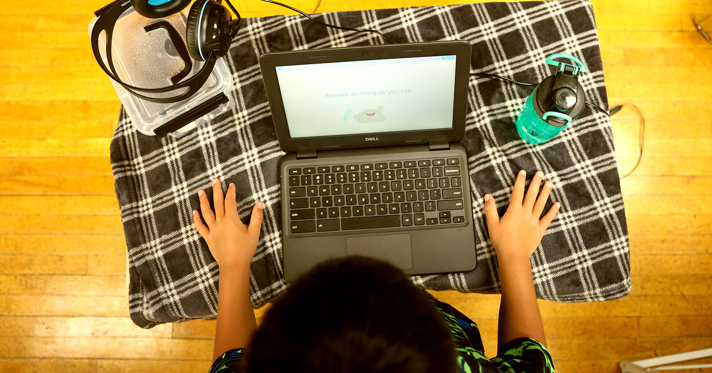

# Alpha School 的真相，比人们想象的更黑暗

> 一年学费 7.5 万美元、以 AI 辅导为核心的 Alpha School，被曝由海外呼叫中心员工通过笔记本电脑摄像头监控学生，还让学生在课堂上戴心率监测器接受点评。

一年 7.5 万美元学费的 Alpha School 把 AI 辅导放在核心位置，学生却形容自己“就像机器人”。

## 每天考试，然后向印度的陌生人解释错题

出于对所谓“彻底崩坏的公立教育体系”的失望，富裕家庭把孩子送进一类叫 Alpha School 的私立学校网络。这里把 AI 辅导放在核心位置，学费高达每年 7.5 万美元。而据最新报道，学生所受的教育堪称离奇——他们更像是一场反乌托邦式实验里的小白鼠。

情况比一开始听上去的更严峻。教育政策作者、认知科学家 Benjamin Riley 的详尽调查显示：孩子们按完成机械作业的能力被相互对立，被境外呼叫中心的雇员通过学校笔记本电脑的摄像头盯着，甚至被要求戴上心率监测器，在课堂上接受对自己作业的点评。

在 Riley 最新的更新中，Alpha School 的往届生回忆，自己像“实验室老鼠”一样通过电脑被监控——监控者不是 AI，而多半是来自大洋彼岸的廉价劳动力。

> “他们几乎每天都让我和另外几个孩子做标准化数学测试，凡是做错的题，我们就得上 Zoom，跟一个通常来自印度的随机陌生人解释每一道错题错在哪、为什么错。我恨透了这件事。”——一名 Alpha School 前学生

正如 Elmira College 媒介研究主任 Matt Seybold 在 Bluesky 上指出的，这一披露凸显了 AI 的“机械土耳其人问题”——所谓“人工智能”，实际上是全球南方人类的认知劳动。就在本周，404 Media 报道称，Meta 声称其名为 Muse 的 AI 工具可以替用户打电话给商家，而那些电话实际上是呼叫中心里的真人打出去的。

Alpha School 的软件还会追踪学生的面部表情，持续监测他们的情绪状态，这自然让学生深感痛苦。

## “火箭飞船”与“海盗船”

据 Riley 的报道，学生还被编入各种“内部项目”，其中包括 Rocket Ship。一位前学生形容那“基本上就是他们的聪明孩子俱乐部”，成员可以“想干什么就干什么”。

这些聪明孩子“几乎没有规矩”，“想做什么都行”，甚至“在学校时段也不必真的来学校”。另一个叫 Pirate Ship 的项目，据称是把表现不太好的孩子编在一起。

> “我九年级的时候，他们把我降到六年级数学。他们把我的学分搞乱了。这是故意的，就是为了让人走不掉。如果你的学分乱成一团，想去别的学校可能都毕不了业。”——另一名 Alpha School 前学生

“我们差不多就是机器人，”这名学生补充道。

## “你已被核爆”

学生们还回忆起“被核爆”（getting nuked）的经历：当他们在电脑上的测试没有跨过某个分数线时，除了一个学校专有的学习应用之外，“整台电脑”都会被关闭。屏幕上会出现“一张开玩笑式的蘑菇云图”，宣布“你已被核爆”——据学生说，即便追踪软件判定错了也会这样。

据报道，学校管理层不得不与学校的软件团队沟通，而后者大部分“外包到了其他国家”，这个“绕来绕去的过程”可能要花上好几天。

Alpha School 尚未回应 Riley 最新提出的问题。他在结语中写道：“我无论说什么，都不可能比这里分享的学生声音更有力地说明 Alpha School 的反乌托邦恐怖。所以我只想说这一点。”

“Alpha School 的公开叙事已经被不可修复地击碎，”Riley 写道，“在它对孩子们在教学和心理上的全部伤害被彻底揭开之前，我不会停下。”
