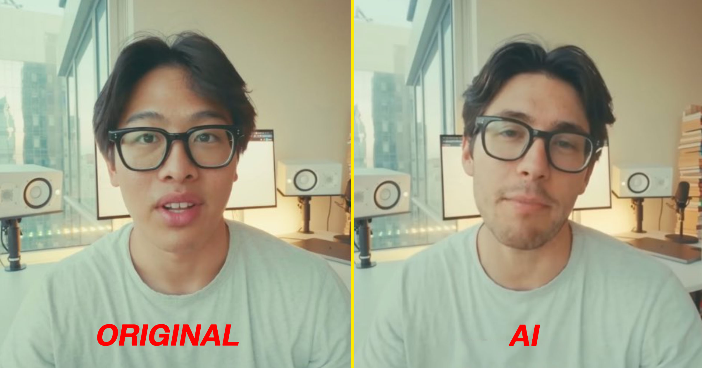

# Kalshi 承认用 AI 套随机网友视频换脸种族改编广告

> AI 预测市场平台 Kalshi 被曝直接套用科技 YouTuber 的原始视频，通过 AI 换脸把他"变成了一个白人男子"来拍广告——公司承认确实用了 AI 生成广告，还称"已停止使用"。

Kalshi 被曝用 AI 把网红的真实视频改得面目全非，还换了种族，公司承认曾用过此类广告。

## 随机网友的视频被拿去当素材

随着公众对廉价 AI 生成内容"垃圾 slop"的反弹不断升级，不少公司仍在继续靠 AI 压低成本来制作广告。有些家倒是把这股歪风玩到了极致：直接把真实网红上传的视频内容偷过来，用深度伪造技术重新包装，顺便给主角打一针营销软粉。

AI 预测市场平台 Kalshi 最近就因为这事被告上了台面。科技 YouTuber 埃利奥特·乔伊（Elliott Choy）发现，自己的某段视频被 Kalshi 直接抓去制作了一则 YouTube 广告——广告里的"他"居然被 AI 改了脸，变成了一个并不存在的白人男子。

## 不仅偷还顺手换种族

乔伊指出，这事儿特别恶心的地方在于，Kalshi 不仅赤裸裸地盗用了用户原创内容，还顺手给视频里的主角换了脸、把亚裔美国人"白化"了——反正最后还得替产品说好话。乔伊还提到，这种事刚被发现没多久，斯坦福大学也因为用 AI 把一张学生合照里的学生替换成了一个"根本不存在的黑人女性"而陷入争议。

讽刺的是，乔伊平时可是在给 Anthropic 的 Claude 助手投放广告。

被 Kalshi 剽窃的原始视频要追溯到去年 9 月，是乔伊分享的关于自己在纽约换新公寓的日常内容。

## 道歉式表态："我们已不再用"

NPR 记者鲍比·艾林（Bobby Allyn）随后调查确认了这则 Kalshi 广告的真实性。一位 Kalshi 代表在回应中表示，那是"旧广告，他们已经不再使用 AI 生成的广告"，还说公司正在"重新审视与制作该广告的代理商的关系"。

但困惑仍有很多。是哪家代理商替 Kalshi 做了这则广告？有多少网红的内容被公司剽窃过？公司是否有打算主动向其他受害者弥补道歉？全部悬而未决。

## 其实早有先例，问题在于公司

艾林最早是在去年 7 月注意到这种趋势：TikTok 上充斥着用深度伪造技术克隆既有用户生成内容的视频，累计播放量高达数千万次。不过那时候的大部分此类视频似乎出自骗子之手，而非什么主流公司为了做广告。

"用今天的 AI 工具做这种事太容易了，很容易就能钻到内容审核的空子里，"加州大学数字取证专家哈尼·法里德（Hany Farid）当时对艾林说。

## 左手 AI 右手真人明星，诚意几何

事实上，Kalshi 在广告营销方面玩 AI 也不是最近才开始的。去年 NBA 总决赛期间，他们播出过一则号称制作成本仅 2000 美元的 AI 生成广告——当然，论效果是否物有所值，大家可以自行判断。

此后随着对 AI 垃圾内容的抵制声音迅速膨胀，Kalshi 反而急转弯，开始请真人明星代言，包括演员蒂莫西·柴勒梅登（Timothée Chalamet）以及奥斯卡获奖摄影师。

Kalshi 增长负责人基顿·英格利斯（Keaton Inglis）今早些时候在接受《广告时代》采访时曾表示："我看到几乎每家品牌都在用 AI。而我让我们从 AI 领导者转型为尽可能——尽可能真人——的方向。"

但一边宣称要转向"真人”，一边广告里还在偷偷替换网红脸色、调整种族，这番表态够尴尬的。
