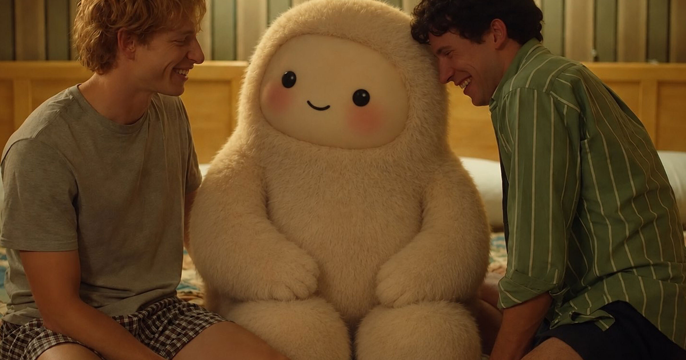

# 人们已对 Meta 新 AI 助手 Muse 产生迷恋

> Meta 给自家新 AI 产品 Muse 造了个萌系吉祥物"Jolly"，并由天才少年 Alexandr Wang 亲自带货——结果网友的脑洞远超预期，直播间里都能看到 Jolly 的"热辣"场景。

Meta 为新 AI 助手 Muse 打造吉祥物 Jolly，网友脑洞大开，生成了各式各样的"二创"内容。

## 硅谷没人这么搞吉祥物

在 AI 产品营销的世界里，Meta 这次算是做了件与众不同的事——他们给 Muse 造了个吉祥物，而且真的花心思去推。OpenAI 和 Anthropic 这些对手可从来没这么玩过。微软倒是尝试过给 Copilot 弄个叫"Mico"的形象，但推广力度完全不在一个数量级上。

现在的问题是：有没有奏效？至少从 Meta 的用心程度来看，他们是真想把 Jolly 打造成病毒式热点。Jolly 的形象大概有点像 Labubu 和 Fall Guys 豆子的混合体，看着挺讨人喜欢。

## 天才少年亲自宣传，内容不太阳光

推动这场营销的是 Meta Superintelligence Labs 的负责人 Alexandr Wang——这位朝气蓬勃的（还是 Zoom 一代的）高管，最近一直在各社交平台上疯狂发帖，内容全是 AI 生成的 Jolly 迷惑图，其中不乏擦边球。

有张图里 Jolly 探头朝后，眼睛卖萌、屁股朝向观众，显然是为了宣传 Muse 接入云存储系统 Box。还有一张直接复刻了 2023 年电影《对手》（Challengers）里那个著名的三人接吻场面——扎克伯格用 Jolly 代替 Zendaya，跟两个男人玩起了"谁都不要"。

还有一条让人联想到马龙 5 歌手亚当·莱文（Adam Levine）那些堪称尴尬的色色短信丑闻：有人生成了 Jolly 的屁股照片发给莱文的 DM 账号，显示莱文当场精神崩溃的样子。

Wang 配文"some of y'all way too thirsty for muse"，仿佛根本没掩饰自己就是在故意召唤这种擦边内容。反而还挺奏效的。

## 网友太会玩了

确实有人搞出了让人脸红的内容：有 Jolly 两腿分开等着接货的图，也有网友生成的视频里 Wang 老老实实在给 Jolly 的鼓鼓脸颊抚摸。高潮當然是复刻某个著名成人迷因的那一张。

Meta 确实下了血本想把 Jolly 留住。GitHub、Spotify 这些品牌纷纷加入，发布了自己的 Jolly 改编图，还宣布集成了 Muse。Meta 还推出了一个功能，允许用户自定义 Muse 吉祥物的外观甚至更换声音。另外还预告了一款类似电子宠物"珍妮龟"（Tamagotchi）硬件设备"Charm"，让用户随时随身带着这个 AI 助手。

如今的景象是：只要你最近打开过 Instagram 或 Facebook，总会在某个地方瞥见 Jolly 的身影。对于这个小家伙，暂时还没有逃脱的可能性。
