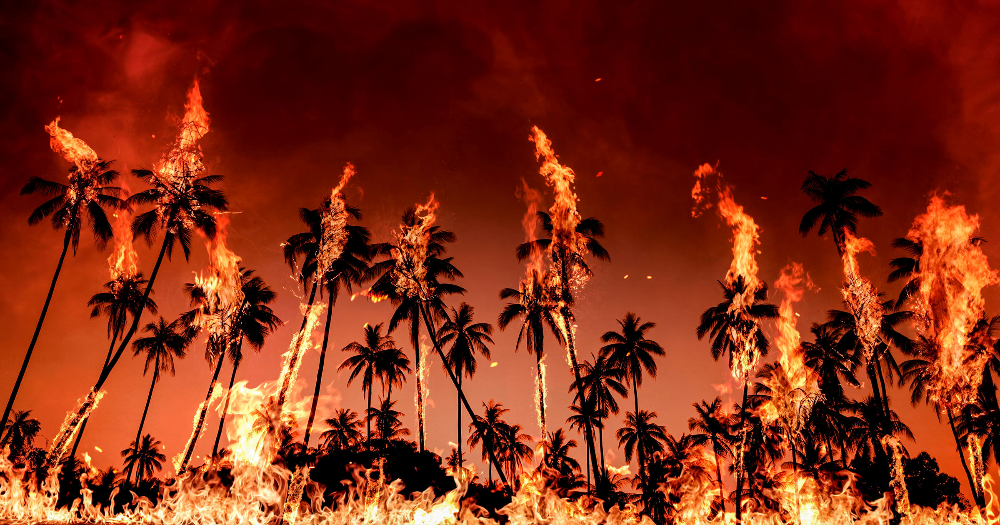

# 全球迎接近五十万高温死亡：超级厄尔尼诺的账单

> 气候研究机构 Climate Impact Lab 的最新报告估算，本轮厄尔尼诺前半程将比正常年份多出约 45.1 万例与高温相关的死亡，而这一气候模式至少要持续到 2027 年春天。

高温、干旱与极端天气在南半球多国叠加，研究人员警告今年的厄尔尼诺是「来自未来的一张明信片」。

## 45.1 万，一个冷冰冰又具体的数字

随着气候变化不断露出狰狞面目，今年夏天对全球大片地区来说格外残酷。一种「超级厄尔尼诺」——这一周期性自然气候模式被强化的版本，会触发异常高温——造成了一场「完美风暴」，用极端天气威胁着数量惊人的生命。

前景黯淡，甚至可以说是灾难性的。据研究机构 Climate Impact Lab 科学家的最新报告，本轮厄尔尼诺的前半程，约 45.1 万条生命「将因高温而逝去，这是相对于正常年份而言」。

> 「45.1 万人这个估算数字大到近乎让人麻木，但它是由父母和孩子、祖父母和邻居、去上班的人、照料家人的人和过着日子的人组成的。」——报告联合创始人、芝加哥大学教授 Michael Greenstone 在随附声明中说。

情况不容乐观。当前的气候模式至少要延续到 2027 年春天，这意味着死亡人数还可能进一步攀升，尤其是明年 6、7 月，高于均值的温度和与高温相关的死亡仍将持续。

## 受冲击最重的是南半球

受创尤为严重的地区大多位于南半球。预计未来六个月里，北非、东南亚和拉丁美洲各地的与高温相关死亡增幅最大。Climate Impact Lab 认定的受影响最重国家包括尼日利亚、印度尼西亚、苏丹、印度和巴西。

不过，人类并非完全无能为力。在人道组织的协助下，各国政府可以发布高温预警、主动联络脆弱人群、提供避暑中心与补水站，并按需扩充医疗系统的承载能力。

> 「这份报告让决策者能清楚看到，现在可以在哪些地方采取紧急行动，从而在未来几个月里挽救数万条生命。」Greenstone 在声明中解释。

然而，要真正有效介入、至少救下其中一部分人，未来可能会因气候变化恶化的影响而愈发困难。

## 「来自未来的一张明信片」

Climate Impact Lab 因此发出不祥的警告：今年的厄尔尼诺是一张「来自我们未来的明信片」。

> 「加强应急响应、更精准地投放资源，今年能挽救许多生命，」报告合著者、加州大学伯克利分校助理教授 Tamma Carleton 在声明中说，「但二十年之后，一旦今天这样的极端温度成为常态，我们不希望自己陷在永久的紧急状态里。」
