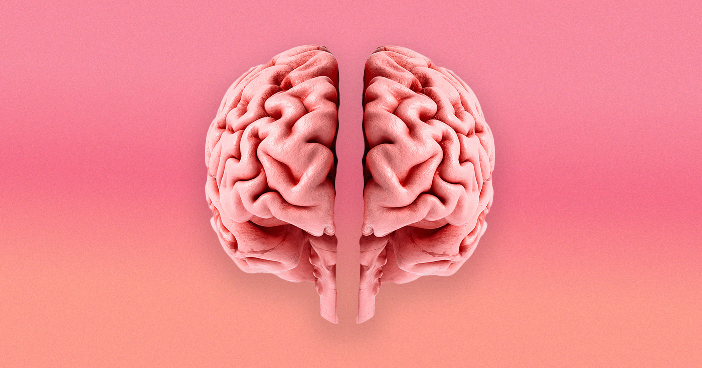

# 斯坦福科学家发现人类大脑其实是两个独立器官

> 斯坦福大学团队在《自然神经科学》发表的研究首次证实，人类大脑前端和后端是分别起源于不同祖细胞、独立进化了数亿年的两个器官。

斯坦福科学家发现人类大脑由两个独立器官组成，各自经历了数亿年的独立进化。

## 大脑其实是“两兄弟”，不是“一家人”

几个世纪的科学积累下来，人类大脑依然是个谜。它由数百亿神经元构成，每个神经元都能跟邻居建立连接——体重僅三磅，却决定了从肢体运动到感官解读，再到认知的全部人生。连最基本的结构，直到今天还是学界激烈争论的话题。

斯坦福大学领衔的一个团队在《自然神经科学》上发了篇新论文，结论有点颠覆常识：人脑在演化意义上 technically 是两个独立器官。前脑和后脑分属不同的“祖先细胞”，各自在漫长的进化里独立发展，最后合在了一起。

这件事如果是真的，等于推翻了过去那个“大脑是单一器官、走的是一条演化路线”的主流假设。还能重新理解人类到底是怎么长成现在这副模样的。

## “蜥蜴脑”理论终于有了硬证据

这个发现还让 오랫동안争论不休的“蜥蜴脑”理论挺了起来——也就是人类除了高级认知之外，脑里还残留着一个更原始的部位，專門维持心跳、呼吸这种活下去必需的功能。另一部分负责更复杂的事，像是创造力，当然，还有抑郁焦虑。

资深作者、斯坦福发育生物学副教授凯尔·洛（Kyle Loh）在声明里说：“我们第一次证明了大脑前端和后端起源于完全不同的祖细胞。”

他还解释说：“这意味着我们现在能在培养皿里培养后脑神经元，研究它们的功能。”

传统模型认为：大脑前部管高级思考和意识，后脑（hindbrain）管最基本的活下去的自动功能，比如呼吸。但后脑细胞一直难在实验室里培养，这也严重拖了研究相关疾病的后腿。

## 小老鼠身上找到了分裂的起点

研究人员盯着小鼠胚胎最早期的发育过程，看到小鼠体内产生了两种不同的脑部祖细胞——一种最后形成前脑和中脑，另一种变成后脑。

这两个区域的染色质（chromatin——装DNA的DNA-RNA-蛋白质复合体）完全不同，各自走上了独立的发育路线。

共同第一作者、斯坦福研究生雷扬·乔克海（Rayyan Jokhai）说：“之前想制造后脑神经元的尝试，估计都是想把前脑/中脑祖细胞说服它们变成后脑细胞——但我们这项研究显示根本不可能做到。”

他还补充：“干细胞生物学里，人们总是迷恋制造最终的细胞类型，比如神经元。但重要的是要从胚胎发育的最早期开始。我们对这个早期时间点的仔细关注，让我们找到了大脑发育里这个根本性的分裂。”

## 第一个在实验室里制造出后脑运动神经元

基于这个发现，团队成了第一个成功把多能干细胞（pluripotent stem cells）转换成后脑运动神经元的人。

他们还在其他物种里发现了类似的发育分裂路径：从斑马鱼、鸡，再到橡子蛆——后者可是从进化树上看离人类极远的物种。虽然水母（更远的物种）天生有两个神经系统，但这些发现暗示，这两个器官渐渐长得更正圆，慢慢靠近了彼此。

洛解释说：“我们的研究表明，进化把两个已有的神经系统在空间上推到了一起。大脑作为一个器官理论上应该更高效，但我们依赖着这种原始的方式，把大脑做成了两块拼起来的东西。”

乔克海感到意外：“‘大脑’这个词让人以为是个连续的器官，应该只有一个起源。但哪怕在 5 亿年前，就已经有这些分开的神经系统了，它们现在几乎能像一个整体那样运作——很酷。”

这两条路径长在一起，可能还让人类大脑变得更复杂。洛在接受《新科学家》采访时说：“后脑负责维持生命，后脑亮着灯，进化就能在前脑那边玩票了——犯错、尝试，然后诞生出记忆、创造力这些奇妙的东西。”

---

**原文：** Stanford Scientists Find That the Human Brain Is Actually Two Separate Organs
