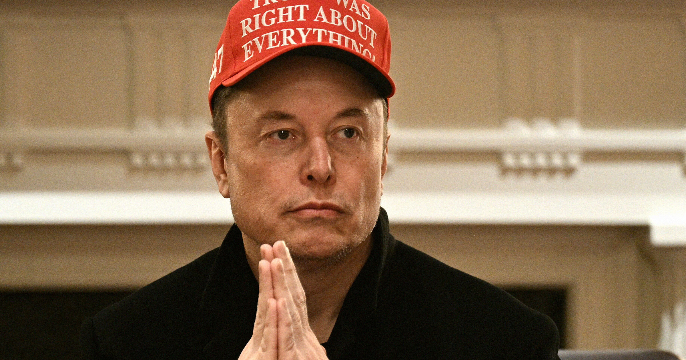

# 特斯拉法庭称 N 字词在特定情况下可接受

> 特斯拉在加州法庭为6000多名黑人工人辩护时竟称 N 字词在某些情况下是"尊重和亲昵的叫法"——而原告描述的可是白人经理朝黑人员工泼辱这个词、把车间比作"种植园"的惨状。

特斯拉在加州法庭为本社工场的种族歧视行为辩护，律师称 N 字词在某些情况下是"尊重和亲昵"的表述。

## 一开庭就开始自我辩护的漂移

埃隆·马斯克脑子里到底安插了什么样的怪孽，似乎正在向外扩散到他旗下 companies 的每个角落。

加州政府正在对特斯拉 Fremont 旗舰工厂展开一场审判，指控对象是6000多名黑人工人。可特斯拉的律师们在为马斯克这家电动车公司辩护时，开门先给法官献上的不是道歉，而是一个相当惊悚的论点——他们主张在某些特定情况下，使用 N 字词是完全可以接受的，因为这个词在黑人社区里本就是"表达尊重和亲昵的术语"。

这听起来像什么呢？好吧，确实有许多黑人确实重新占有了这个词汇。但这场官司起诉的可不是黑人同胞之间的玩笑式互称，而是非黑人特斯拉员工和经理对黑人工人的虐待——那些把这个侮辱性词汁往黑人脸上扔的举动，怎么听都不像半分"尊重和亲昵"。

## 第一位证人就揭了老底

更令人瞠目的是，第一位出庭作证的证人 testified，案子开审前几天特斯拉高级法律顾问曾试图误导他，谎称自己是代表"加州政府"，而不是特斯拉这家电动车公司。据 Electrek 报道，检察官们还指控特斯拉律师事先接触了另外四位潜在证人，而这些人此后都从检察官的视线中"失踪"了——可能是达成了某种交易，或者是受到了公司法律团队的威胁或游说。

## 车间被称为"种植园"

这场令人咋舌的张口就错的 courtroom 表现，出现在加州政府主导的一场重型审判的第一天。当然，这次并非传统意义上的集体诉讼，而是由州政府自己出面 prosecution——这意味着如果政府赢了，特斯拉可能面临的赔偿金额是没有上限的。

早先 Electrek 的调查曾揭露，Fremont 工厂的黑人工人长期遭受工资差别对待、工作区隔离，以及各式各样的种族辱骂。工人们投诉称，工厂管理层 routinely 使用 N 字词，还把普通员工叫作"奴隶"。这种骇人听闻的话语模式让工厂在员工中间有了个坏名声——直接被叫作"种植园"。

除了言语侮辱之外，Electrek 还报道说，工厂内高流量区域经常出现种族主义涂鸦和卍符号，而特斯拉管理层对此始终装作没看见。

## 审判将持续到 10 月底

这场案子预计要打到 10 月底才能结束。更关键的是，因为是州政府自己 prosecution，而不是传统的集体诉讼，赔偿金额没有 caps——如果加州赢了，特斯拉将面临一笔可能是天文数字的赔付。
