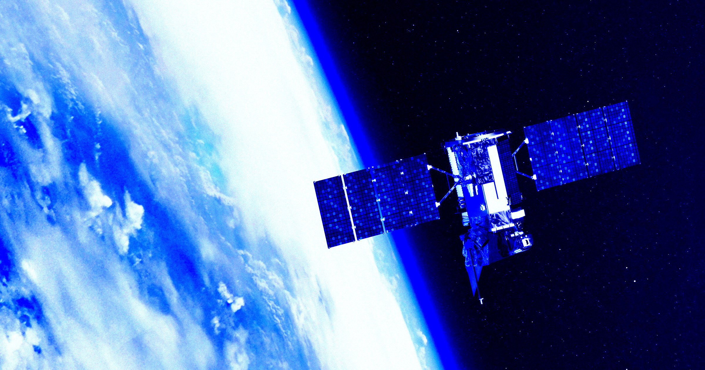

# 谷歌要把数据中心送上太空，下周先发一颗冰箱大小的试验星

> 谷歌最快下周就会把一颗冰箱大小、算力约等于单台服务器的试验卫星送上轨道，作为 Project Suncatcher 的第一步。它想用太空里全天候不衰减的阳光给 AI 数据中心供电，免得压垮地面电网；但太空碎片、辐射、散热和维修难题，都还远未解决。

谷歌的 Project Suncatcher 想把 AI 数据中心送上轨道，下周将先发射一颗冰箱大小的试验卫星。

## 一颗冰箱大小的"太空数据中心"

盯上轨道数据中心的，不只是马斯克的 SpaceX 和贝索斯的蓝色起源。谷歌也想入局——它最快下周就会发射一颗冰箱大小、算力约等于单台服务器的卫星。

据《纽约时报》报道，这颗原型卫星属于这家科技巨头的 Project Suncatcher（捕日者计划）。顾名思义，其目标是利用轨道上全天候、不经过滤的阳光，为地球轨道上运行的 AI 数据中心供电——从而避免在地面上压垮电网、排放大量污染、耗尽淡水资源。

## 三大拦路虎：碎片、辐射、散热

谷歌这样的公司距离弄清它到底行不行、以及财务上是否可行，还有很长的路要走。障碍包括：乱飞的空间碎片，可能把庞大的轨道数据中心打成瑞士奶酪；大量的太空辐射会破坏星上电子设备，而这些设备还得想办法散热；此外，还要与几百英里之下的地面保持足够稳定的连接。

## 修卫星，比修服务器难太多

更别忘了维护这些服务器本身就是一件极其复杂、且很可能昂贵的事。人类技师可以走进数据中心换掉零件，但要维修卫星，难度高得不可同日而语。

而且，轨道数据中心也并非地球数据中心困境的万能解药。专家警告，庞大的卫星星座可能对生态造成严重破坏，排放大量大气污染物，并危及臭氧层。

## 先跑15分钟，再逐渐扩编

眼下，谷歌的技术人员正在实验室里对首颗 Project Suncatcher 试验卫星做压力测试，之后会把它装上 SpaceX 的猎鹰9号，于10月1日发射。升空后，它将在轨绕地球飞行最长六年，最终在大气层中烧毁。

谷歌研究部门高级副总裁 James Manyika 对《纽约时报》说："坦白说，我们不指望未来几年就能有什么能用的东西上线。"他把这个过程比作研发无人驾驶汽车——谷歌在这上面花了15年。

技术障碍之外，随着轨道数据中心运营规模扩大，工程挑战还可能叠加。马斯克这边，就计划发射多达一百万颗巨型数据中心卫星，每一颗都比国际空间站还要长得多。

据《纽约时报》报道，谷歌希望在2030年代中期，把在轨道上的开支做到与地面相当，赌的是未来的规模经济。明年，它打算再发射一对卫星，然后逐步扩编成一个由80颗卫星紧密编队组成的星座。

目前，它还只是迈着小步走——卫星在太空中每次只能运行15分钟，之后芯片就必须关机降温。
