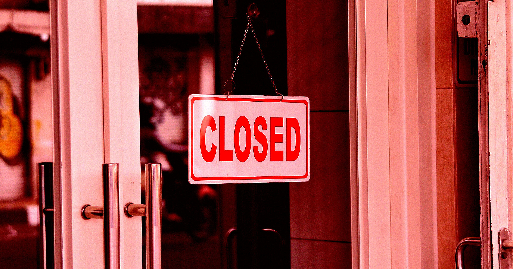

# AI 初创公司百家24小时咖啡店计划现实崩解

> 估值40亿美元的AI保险初创公司 Corgi，曾许诺6个月内在旧金山开100家24小时咖啡店，如今咖啡项目被迫停摆，数名相关员工被解雇。

AI保险公司 Corgi 曾在旧金山推出品牌咖啡店，幻想用AI革命咖啡业务，结果许诺落空。

## 从保险到咖啡的跨界野心

Corgi Insurance 是一家估值高达40亿美元的AI保险初创公司，成立仅两年就获得了令人咋舌的估值。然而除了保险业务外，公司还曾做出了一个让外界错愕的计划：在旧金山量产自家品牌咖啡店，目标是在6个月内开设100家，每月至少17家，营业时间更是打算做到24小时。

这个数字听起来肉眼可见的宏大，实际进度却是另一回事。据《旧金山纪事报》报道，Corgi 在短短一周前就已经解雇了部分专门负责在城市各处落地咖啡店项目的员工。与此同时，公司旗下的两家咖啡店中，有一家还因为被发现没有合法经营许可而被市政官员勒令关闭。

## 乱枪打鸟的扩张节奏

熟悉 Corgi 动向的房地产经纪人告诉纪事报，公司在扩张过程中采取了一种近乎"撒网式"的做法——同时在市场上寻求多个新的门店租赁，可内部战略却摇摆不定，完全不成体系。

"他们基本上是在同一时间找市场上的每一个人谈。"有知情人士对外透露。结果就是，虽然签了许多商店迹目标，却始终没能在既定目标上迈出实质一步。计划严重缩水后，公司内部被定性为一场"内部重组"，至少两名内部人士因此被送走。

## 被拷问的AI光环

这场咖啡店梦的破产背后，其实是投资界长期以来对"AI"标签近乎疯狂的押注。Corgi 仅用两年就飙到40亿美元估值，业务基础究竟是自研AI，还是像外界质疑的那样——把开源软件包装一下就算自己的创新——一直是外界争论的话题。

Corgi 创始人自然否认了这种说法，但这并不妨碍这场闹剧成为又一个典型案例：美国风险资本过去对那些看似脑回路奇特的初创公司出资飞多，而一旦贴上AI标签，似乎更是毫不手软。
