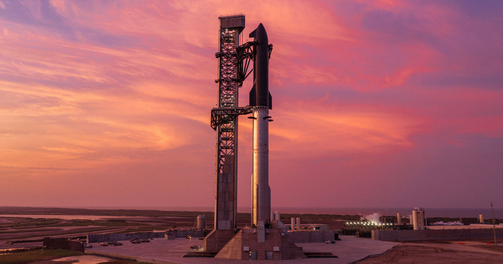

# SpaceX 周一将迎来公司史上最重要的一次发射

> SpaceX 计划周一进行星舰的第14次试飞：飞船要以171英里高度绕地球整整六圈、在轨飞行十小时后软着陆。上一次试飞中，超重型助推器有3台发动机未能重新点火、硬着陆爆炸；而这一次的成败，直接关系到 NASA 定于2027年的 Artemis 3 登月任务。

SpaceX 计划周一进行星舰的第14次试飞，这可能是公司史上最关键的一次发射。

## 上次差在助推器

近来，SpaceX 的星舰研发似乎一直处在某种原地踏步的状态。

公司上一次发射是在7月，也就是将近三年半里的第13次全尺寸试飞。那次飞船成功部署了20颗可运行卫星，但超重型（Super Heavy）助推器的13台猛禽（Raptor）发动机里，只有10台在着陆阶段重新点火，导致它重重砸下并爆炸。

现在，这家航天公司想把这个着陆真正做稳。按计划，公司将于本周一执行第14次试飞——"有待监管批准"。方案是让星舰在171英里（约275公里）的高度绕地球整整六圈，飞行十小时，然后轻缓落地。

这几乎是这套发射平台迄今最大的一次考验，也可以说是公司史上最重要的一次发射。要想让星舰能够按固定节奏投送卫星，证明它的轨道飞行能力是生死攸关的一步。这同样也是 NASA 计划中的 Artemis 3 任务的关键一环——该任务目前定在2027年，是这家航天机构重返月球表面雄心的重要跳板。

## 这次要绕地球六圈

不过，考虑到 SpaceX 仍有大量难关要过——从可靠入轨，到让飞船和助推器都能稳稳着陆——在明年把 NASA 宇航员送上它的飞船、进入地球轨道之前，SpaceX 或许还需要给自己多争取些时间。

本周早些时候，SpaceX 已在周一发射窗口前成功完成了一次全流程湿式彩排：不点燃任何发动机，团队把倒计时程序完整跑了一遍，确认一切就绪。

吸取上次试飞的教训，SpaceX 修改了超重型助推器的硬件，以确保所有发动机都能点火，并引导它安全溅落于墨西哥湾。公司官网写道："本次飞行中的超重型助推器在硬件上做了改进，以提升发动机的过滤能力，并在软件上做了调整，以增强重新点火的可靠性。"

## 回收瓷砖，也要送星链上天

在轨飞行近十个小时后，星舰将尝试溅落在智利以西的太平洋上，并使用升级过的隔热盾，确保它在再入时不会烧毁。公司甚至还会复用两块从上次试飞中回收的隔热瓦——这是"星舰首次实现隔热瓦复用"。

这次它还将部署26颗 Starlink V3 卫星，以"大幅提升网络的容量和用户网速"。

## 猎鹰9号的退场倒计时

下周发射的成败，牵动的东西很多。公司正准备逐步让主力火箭猎鹰9号退役，转投大得多的星舰平台——后者理论上每次发射能投送的卫星数量约为猎鹰9号的十倍。

至于这条路能否走通，尤其是 Artemis 版本能否成功完成地月转移注入、并把宇航员送上月球表面（最快可能是"2028年初"），答案也许下周一就能初见分晓。
