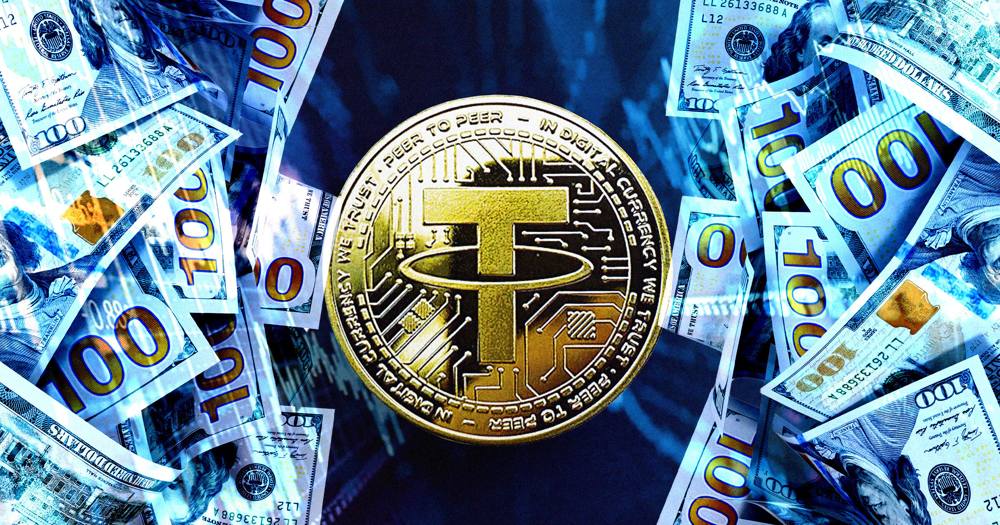

# 美国司法部查扣Tether银行账户，稳定币"数字黄金"人设再受质疑

> 据《金融时报》报道，美国司法部已从与 Tether Limited 相关联的多个银行账户和加密钱包中查扣数百万美元。Tether 与 Bitfinex 都坚称自己只是涉案机构 EQIBank 的客户，对司法部指控的欺诈行为毫不知情。

稳定币发行方 Tether 再次因资金往来问题被推上风口浪尖。

## 一起绕不开的支付案

如果你问任何一个加密圈的人，什么是数字世界里的"金本位"，答案大概率是 Tether。但司法部最近的一次行动，让这个说法站不住了。

《金融时报》的报道显示，美国司法部已从一批与金融科技公司 Tether Limited 相关的银行账户和加密钱包中查扣了数百万美元。Tether 是"稳定币"Tether 的发行方，这种数字货币的设计目标是锚定美元汇率、保持相对稳定的价值。

Tether 曾是美国联邦调查局（FBI）一项大规模调查的对象之一。该调查发现了一个无牌支付处理业务 Capstone，据称经手了数亿美元的非法转账。这桩案件还牵涉到 Bitfinex——一家由 Tether 母公司 iFinex 持有的加密货币交易所。

## Capstone 如何伪装成一家IT公司

按照指控的说法，Capstone 在与 Wells Fargo、JPMorgan Chase 等正规银行打交道时，谎称自己是信息技术公司。而实际上，这家公司被指参与了一场大规模欺诈：据路透社报道，与 Capstone 有关联的人冒充FBI探员，专门诈骗老年人，骗来的钱随后被换成加密货币。

从目前掌握的信息看，这两家加密公司更像是被卷入的无辜旁观者，而非主动参与者。Tether 与本案的联系，是通过一家名为 EQIBank 的离岸法律实体建立的——Tether 的资金正是经由 EQIBank 流进了 Capstone。

## Tether 和 Bitfinex 的辩解

在给《金融时报》的声明中，Tether 和 Bitfinex 都强调自己仅仅是"EQIBank 的客户"，并且"对司法部所指控的 Capstone 欺诈行为毫不知情"。

> "Tether 和 Bitfinex 是 EQIBank 的客户，对司法部所指控的 Capstone 欺诈行为并不知情。"
> ——Tether 与 Bitfinex 对《金融时报》的声明

不管真相如何，这件事本身就说明，即便在2026年，加密货币市场依然相当不可靠——哪怕 Tether 手上持有1400亿美元的美国政府债务，哪怕它有美国总统的支持，Tether 显然仍在为接入最基本的金融基础设施而挣扎。

## 为了开一个银行账户，Tether 走了多远

Tether 与 EQI、进而与 Capstone 那些被指欺诈者的全部联系，起源于这家加密公司的一次迫切努力：它想在新加坡发展银行（DBS）开一个银行账户。DBS 在全球金融体系里是举足轻重的机构。

据《金融时报》报道，Tether 曾提出，只要 EQIBank 能帮它"成功开设至少一个银行账户"，就愿意对 EQI 进行一笔可观的投资。这个目标在FBI的调查把一切摊到台面上之前并未实现。DBS 向《金融时报》表示："DBS 从来无意与非法资金或不正当交易产生任何关联。"

一家发行着全球流通量最大稳定币的公司，为了开一个普通银行账户，需要绕道离岸机构、许诺投资、最后卷入一桩冒充FBI探员诈骗老人的案子里——这大概就是"数字黄金"叙事的现实版本。
