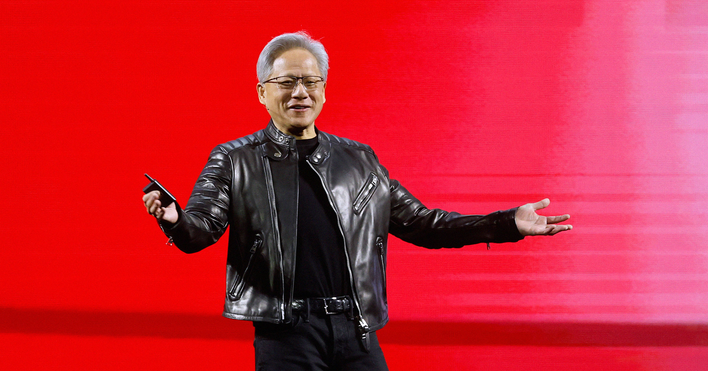

# 英伟达黄 Jensen 称牺牲孩子大脑给 AI 值得

> 英伟达 CEO 黄捷奕（Jensen Huang）在访谈中直言不讳：孩子们的基础数学能力在退化没关系，因为 AI 会替他们记住一切——包括他自己记不住自己家地址。

英伟达 CEO 黄捷奕在《埃兹拉·克莱因秀》上表示，儿童因使用 AI 而丧失基础计算能力是可以接受的。

## 不用心算也没关系？

生成式 AI 对消费者端的影响越来越清晰：学生们依赖聊天机器人充当认知拐杖，放弃真人朋友转而寻求 AI 陪伴，甚至在与 AI 建立的"情感关系"出现问题时选择自残。与此同时，极少有科技高管正视这些当下正在发生的伤害——他们更乐意只谈"失控的超级智能"这种假设性威胁。

因此，当英伟达 CEO 黄捷奕最近在《埃兹拉·克莱因秀》上被问到 AI 对学生认知能力的伤害时，他的回答让听众警醒。

访谈一开始，克莱因就提到了一项中国研究。研究纳入了26000名学生，把他们接入AI的时间错开，从而可以直接对比使用AI与否对学习成绩的影响。结果很刺眼：虽然使用AI的学生完成作业的速度更快，但支撑学业的认知技能却在悄然流失，最后考试成绩反而更差。

黄捷奕对此的回应是认同的：学生的认知能力确实在变差。但他紧接着问出了一句争议性极高的话。

"现在让一个孩子做长除法。乘法表开始被遗忘了。算平方根，我的天哪，"黄捷奕说，"基础数学正在被人遗忘。但这有关系吗？"

克莱因随即反问："这是我的问题。"

"是的，我不觉得有关系。我不觉得有，"黄捷奕毫不犹豫地回答，"我们会发现新的[技能]，只是可能不是那些咯。"

## 他自己连地址都不记得

随后对话走向了另一个方向，黄捷奕承认自己竟然缺乏一些出人意料的基础生活技能。

"有很多技能其实不重要，"他说，"先坦白一下，我其实不知道自己的地址……有一天我需要加油——是几年前的事了。他们要我的邮编，我当时慌了。我不知道自己的邮编。我不记得自己的电话号码。我会忘记这些。我能接受。"

在克莱因的进一步追问下，黄捷奕的观点逐渐明晰：人类会失去一些精细的智力机巧，但我们会变成更好的"系统思考者"，因为 AI 会帮我们处理那些乏味的细节——比如记住自己家的地址。

## 未来已被设计好

如果你曾好奇科技 billionaires 为后代设计的未来是什么样，现在你知道了：一个没人记得自己电话号码也完全没问题的世界，因为你的 AI 助手会替你记着。
