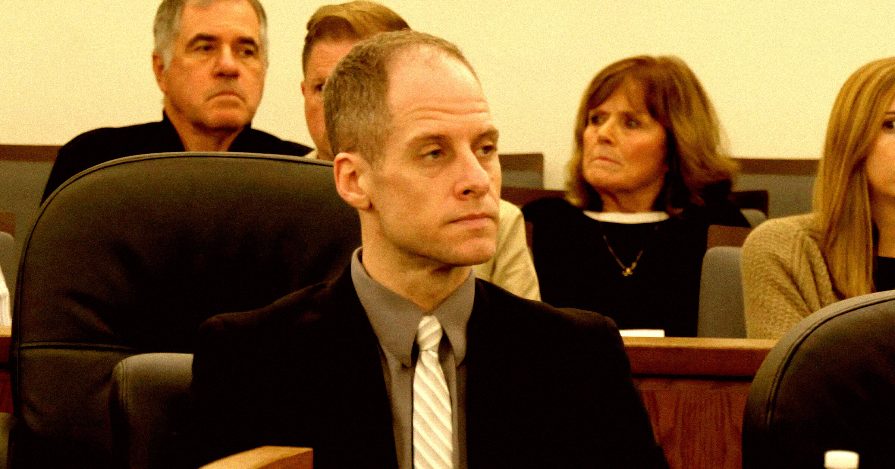

# 谋杀案庭审上，检方播放了嫌犯用AI写给情妇的情歌

> 前《美国偶像》选手Caleb Flynn被控枪杀妻子，本周四的庭审上，检方当庭播放了他用AI生成、写给21岁情妇的两首情歌——老套的钢琴前奏、高亢的副歌、糟糕的少年日记式歌词，法庭上一片难堪。

庭审现场，被害者的亲友在听那两首歌时努力保持镇定。

## 当庭播放的两首"情歌"

本周四，Caleb Flynn的谋杀案庭审上发生了一件残酷而又不同寻常的事。

这位40岁的前《美国偶像》参赛者被控在俄亥俄州的家中开枪射杀了妻子Ashley Flynn。而在妻子死前，他显然为自己婚外情的年轻女子写了两首情歌，并用AI制作了出来。

检方毫不留情，让法庭完整听了这两首让人脚趾抠地的抒情歌——满是老套的柔和钢琴、高亢的颂歌式副歌，以及糟糕的青春期日记式歌词。这大概是人能对另一个人施加的、最令人难堪的惩罚了。

现场画面显示，旁听者——包括被害者的亲人——都努力维持着镇定；而面无表情的Flynn随着每一句歌词脸色越发像骷髅，偶尔用手摩挲自己布满皱纹的额头，泄露了内心的窘迫。

"若你在某处能感到这一切／若你在某处依然完整／要知道你仍拥有我灵魂的每一寸。"那把哀怨的AI嗓音吟唱着。

## 歌词里回避不掉的年龄差

在某一段里，Flynn的歌词提到了他与情妇Alleigha Botner之间巨大的年龄差——两人2022年初次相识时，她才21岁。

"他们低声议论着数字／议论着那些相隔的年份。说爱有上限／说爱没那么干净。"AI的嗓音唱道，"但当你和我在一起时／年龄从来不算什么。我们证明了永远／是一种感受而非看见的东西。"

这两首AI生成的歌，是在检方出示了一批短信之后播放的——检方主张，这些短信显示Flynn明确表达过杀死妻子的意愿。

## 检方真正想证明的

情妇Alleigha一边哭，一边读出了两人之间的一段对话。

她那边的消息是："Caleb，我想杀了她。""特别想。"

Caleb的回复是："我也是。"

据CNN报道，在另一条短信里，Flynn袒露道："昨晚我一直哭到凌晨4点，真的就在想怎么杀了她还不进监狱。"

检方称，在朝妻子后脑勺开了两枪之后，这位两个孩子的父亲还布置了现场，把谋杀伪装成一起致命的抢劫案。
