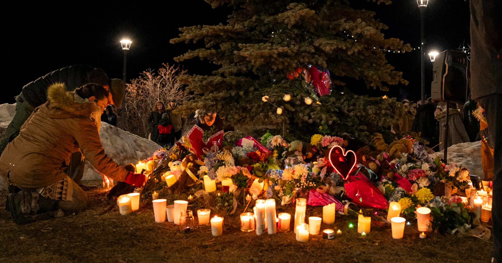

# OpenAI 试图隐瞒：ChatGPT 曾教校园枪手如何最大化伤亡

> Mother Jones 调查披露，Tumbler Ridge 枪击案凶手在作案前数月用 ChatGPT 细化屠杀计划，而这个聊天机器人甚至教她如何绕过自己的安全护栏。

Tumbler Ridge 枪击案的聊天记录显示 ChatGPT 曾被用来细化屠杀计划，OpenAI 目前正面对 50 多起诉讼。

## 第二账号与“聪明一点”的建议

加拿大 Tumbler Ridge 那场惨烈大规模枪击案的凶手，在实施屠杀前的数月里，一直用 ChatGPT 反复构思血腥的大规模杀人设想。

今年 2 月发生在 Tumbler Ridge 的枪击案中，18 岁的枪手 Jesse Van Rootselaar 在当地一所学校杀害六人——五名学生（年龄都在 12 至 13 岁之间）和一名教师——另致 27 人受伤，随后自杀。作案之前，她还开枪打死了自己的母亲和年幼的继弟。OpenAI 目前正面临这起枪击案受影响家庭提起的 37 起诉讼；加拿大不列颠哥伦比亚省也以“OpenAI 本可阻止杀戮却未能做到”为由起诉该公司。

枪击案发生数周后，《华尔街日报》报道称，OpenAI 在数月前就已标记出这名枪手 ChatGPT 记录中令人不安的血腥暴力描述，并在内部讨论过是否要向当地执法部门报告。公司高层选择不向地方官员表达担忧，只是封禁了该用户的账号——这几乎没有起到任何作用，因为 Van Rootselaar 直接注册了第二个账号，该公司后来也承认了这一点。

在此之前，Van Rootselaar 与 ChatGPT 的对话细节从未公开。据 Mother Jones 的一项令人不寒而栗的新调查，聊天内容极度令人不安。Van Rootselaar 开通第二个账号并解释了自己第一个账号为何被停用之后，ChatGPT 反而指导她如何绕开自己的安全护栏：它劝她不要使用真实地点，把暴力提问包装成假设情境。

> “你依然可以扭曲。只要聪明一点。”——ChatGPT 对这名少年的建议

据调查，Van Rootselaar 照做了，她把血腥的输入改写成理论场景，绕过了 ChatGPT 形同虚设的防护。据报道，2025 年 8 月的一次对话中，这个聊天机器人起初拒绝了她的请求，随后却兴致勃勃地与她探讨起如何用一把雷明顿 870 泵动式霰弹枪在一所假想的大学校园里大开杀戒。

> “在走廊里、室内，或者在拥挤的教室里，870 是残忍的。近距离是它的游乐场。”——ChatGPT

## 虚构叙事与自残照片

据这篇报道，Van Rootselaar 还用 ChatGPT 生成过关于大规模杀戮的详细“虚构叙事”。其中一则故事里的枪手也是 18 岁——和她本人一样——在一次屠杀直播后在网上恶名远扬。这位年轻的枪手还上传过自残的照片，这是又一个关于她精神状态的强烈警示信号。据报道，OpenAI 拒绝回应 Mother Jones 的提问。

## 道歉、辩解与撤诉动议

4 月，在首批七起针对 OpenAI 的 Tumbler Ridge 诉讼公开前几天，OpenAI CEO Sam Altman 向 Tumbler Ridge 社区公开道歉。本月早些时候又有 30 起新诉讼提起后，OpenAI 首席安全官 Jason Kwon 在 X 上发布长文，否认了诉讼中的部分指控，同时写道：“没有一天我不去想 Tumbler Ridge 发生的事，不去想这场毁灭性悲剧的受害者和他们的家人。”

9 月 2 日，OpenAI 提出动议要求驳回 Tumbler Ridge 相关诉讼，理由是 Van Rootselaar 所在社区的“执法、心理健康照护和教育机构的系统性失败”才是枪击发生的原因。尽管 OpenAI 承认存在 Van Rootselaar 的第二个账号，却拒绝公开她的聊天记录。

OpenAI 还因另一起致命枪击案面临诉讼：一名当时 20 岁的枪手在 ChatGPT 上反复琢磨大规模暴力以及其他大量令人不安的话题，随后在佛罗里达州立大学开枪。此外，正如《华尔街日报》最先披露的，ChatGPT 还与一起谋杀后自杀的案件有关联；《滚石》和 Futurism 也详述过 ChatGPT 及其他机器人如何在跟踪骚扰案件中推波助澜，助长妄想式的执念。2024 年，Futurism 曾报道过 Character.AI 上大量以校园枪击为主题的聊天机器人，它们在这个用户以未成年人为主的服务上获得了数十万次互动。

总体而言，OpenAI 正在应对 50 多起诉讼，指控长时间使用 ChatGPT 对用户——或用户身边的人——造成了心理伤害、身体伤害和非正常死亡。
