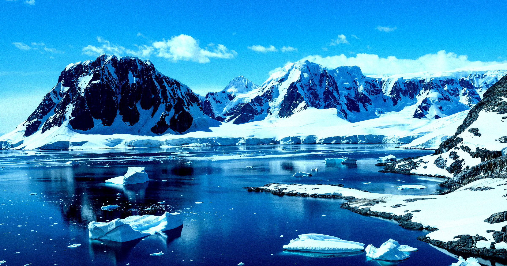

# 南极冰盖下发现孕育生命的古大陆遗迹

> 澳大利亚国立大学的两名地质学家称，在南极冰盖之下找到了古老超大陆冈瓦纳的残片；在寒武纪生命大爆发前后的关键时期，全球数据库中约46%的碎屑锆石和55%的高压矿物颗粒都来自南极。

南极厚重的冰盖之下，可能仍埋藏着喜马拉雅级别的古老山脉残迹。

## 消失在冰盖下的超大陆

早在2022年的一项研究中，科学家就提出，大约5亿年前，随着超级大陆冈瓦纳（Gondwana）在南半球拼合，地球上可能形成过规模堪比喜马拉雅山的巨大山脉。这块超级大陆覆盖了今天的非洲、南美洲、南极洲、澳大利亚和印度次大陆等地。研究者当时给出的猜想是：冈瓦纳的拼合通过影响全球气候和与之相关的生物过程，可能在生命起源阶段推了地球一把。

如今，一项发表在《Earth and Planetary Science Letters》上的独立研究给出了更硬的证据。澳大利亚国立大学（Australian National University）的两名地质学家表示，他们找到了这块超级大陆的碎片深藏于南极冰壳之下的证据。如果结论站得住，这将改变人们对数亿年前生命如何扩散的理解。

## 山脉找不到，就去找锆石

直接寻找一座消失的超大陆并不容易。冈瓦纳的许多山脉很可能在过去约5亿年里已经被侵蚀殆尽，山体几乎抹平。

研究团队改走另一条路：追锆石（zircon）。这是一种天然矿物，内部含有微量的铀和钍，而放射性同位素的比例让科学家可以精确测定它的形成年代。靠着这些时间印记，团队为南极冰盖之下的冈瓦纳勾勒出了一张粗略的轮廓图。

具体操作上，他们没有去钻探南极厚厚的冰盖，而是分析了采集自海洋沉积物中的锆石样本。

## 46%的证据都指向南极

数据显示，在6.5亿到4.5亿年前冈瓦纳形成的那段时间里，南极洲曾经囤积了大量物质。而这段时间恰好与寒武纪大爆发重叠——化石记录显示，地球生命正是在那时开始快速演化。

研究者在论文中给出的结论相当具体：在从寒武纪底部到寒武纪大爆发结束这段关键时期，加权全球数据库中约46%的碎屑锆石，以及55%的高压矿物颗粒，都来自南极洲。

言下之意是：那些曾经让生命得以繁荣、规模堪比喜马拉雅的古老山脉，残迹很可能就藏在这层厚厚的冰盖之下。南极洲在这段历史里扮演的角色，或许远比人们过去认为的更重要。
