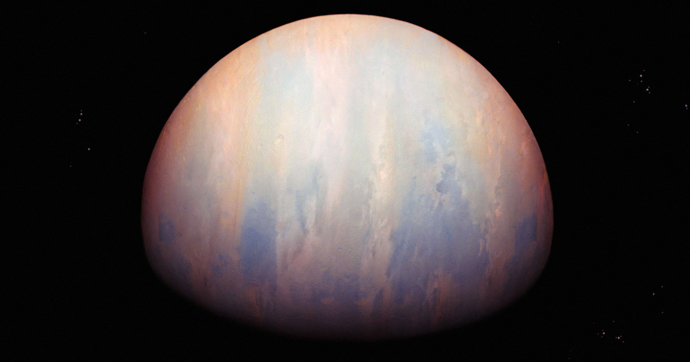

# 哈佛团队首次直接探测到太阳系外行星发出的射电信号

> 借助南非的 MeerKAT 射电望远镜，哈佛与俄勒冈大学的团队首次直接捕捉到一颗系外行星发出的射电信号，并借此测出它的磁场强度是木星的 300 多倍。

这颗名为 beta Pictoris b 的气态巨行星距离地球 64 光年，其射电辐射来自行星磁场中带电粒子形成的极光。

## 从行星本身、而不是宿主恒星听来的信号

到目前为止，天文学家已在太阳系之外确认了 6300 多颗绕宿主恒星运行的系外行星，从小型岩石世界到木星、土星那样的巨大气态球体都有。科学家推测，其中一些可能孕育生命，因为它们运行在宜居带内——那里的条件恰好允许液态水存在于行星表面。

受制于难以想象的遥远距离，近距离窥探这些世界一直困难重重。要把系外行星发出的信号从其明亮得多的宿主恒星中区分出来，更是长期无法逾越的挑战——直到现在。

在一篇尚待同行评审的论文中，来自哈佛大学和俄勒冈大学尤金分校的一组天体物理学家称，他们利用南非的 MeerKAT 射电望远镜，首次直接探测到了来自一颗系外行星的射电信号。

这颗行星名为 beta Pictoris b，是一颗质量超过 11 个木星的气态巨行星，绕宿主恒星一圈要花超过 23 个地球年。它于 2008 年被首次发现，距地球约 64 光年。这当然不是某个住在这颗气态巨星上的外星文明在联系我们——这些射电辐射看起来是自然产生的极光造成的，即带电粒子沿行星磁场运动的结果，和地球上的极光并无本质不同。

> 「我们在 0.85 到 3.5 GHz 频段探测到快速、重复且高度圆偏振的爆发，以及持续性的辐射。」——研究人员在论文中写道。

## 靠类星体当「灯塔」定位

研究团队利用已知类星体位置来确定信号的确切来源，从而把信号从这颗行星的宿主恒星 beta Pictoris 中分离出来。类星体位于星系中心，由超大质量黑洞驱动，极度磁化且明亮，天文学家把它们当作「灯塔」，用来三角定位其他遥远天体的位置。

这次直接的射电辐射探测，还让团队得以确定这颗系外行星的磁场强度是木星磁场的 300 多倍。

> 「这是对系外行星磁场强度的首次直接测量，结果与针对一颗年轻、大质量巨行星的发电机标度预测相符。」——研究人员在论文中写道。

## 能听见，但还是去不了

尽管我们如今能分析它们的射电波辐射，亲自造访这些遥远世界仍是遥远的梦。即便人类制造的最远航天器旅行者 1 号，也才缓慢接近距地球一个「光日」的距离；而最近的恒星系统比邻星——据信拥有一颗「超级地球」系外行星——也有 4 光年开外。
