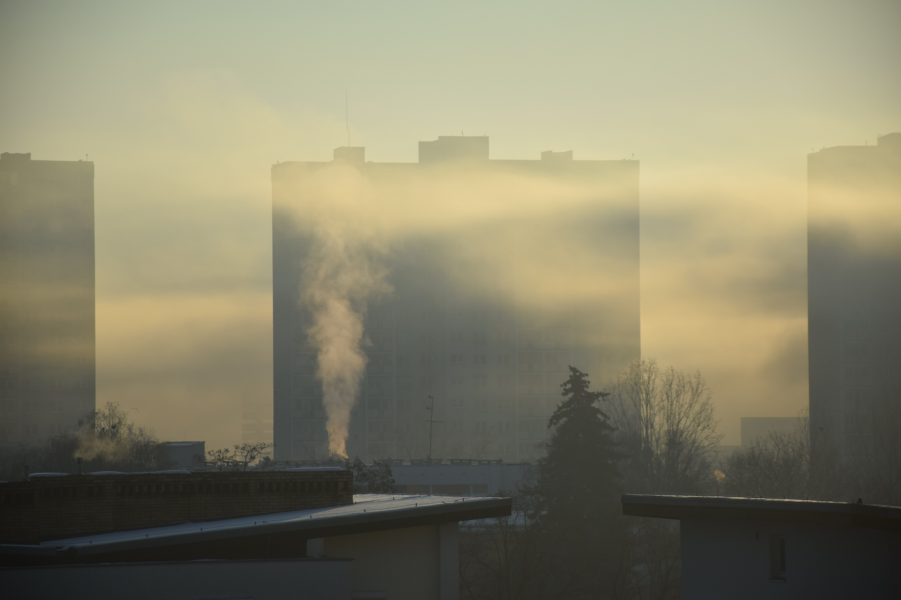

# 数据中心排毒气被罚100万美元

> 新泽西州南部一座数据中心被查出偷偷装了 62 台燃气发电机往社区方向排放废气，州环保部门开出 100 万美元罚单——这是该州有史以来对数据中心开出的最大罚单。

数据中心建起来之后，它与周边居民之间的账并没有算完。

## 机房上线了，仗却没打完

在美国，围绕新建数据中心的激烈地方抵制，仍在持续缠住那些想从 AI 热潮中套现的开发商。草根组织者已经对大约 1300 亿美元的数据中心投资发出了威胁，但这些努力并非总能奏效，而一旦设施扎下根来，几乎不可能再把它赶走。

可即便数据中心已经上线，角力也远未结束。新泽西州南部的 DataOne 设施就是例子：检查人员在现场发现了一批非法安装的燃气发电机，正向周边社区喷吐烟雾，新泽西州环境保护厅（NJDEP）随即开出 100 万美元罚单。

## 62 台发电机干的“私活”

据 Gothamist 报道，这座位于新泽西州 Vineland 的数据中心被查出在未获州政府批准的情况下运行了 62 台燃气发电机。这种做法正变得越来越普遍——胃口极大的算力设施撞上了公共电网的供给上限，自备发电便成了灰色选项。

“这次执法行动——无论以新泽西对数据中心开出的罚单规模衡量，还是放到全美来看，都可能是最大的一笔之一——传递了一个清晰的信号：这类设施在本州不会不受约束地建设和运营。”NJDEP 专员 Ed Potosnak 在声明中说。

## 居民盯了很久，罚单才落地

对当地人来说，这张罚单来得并不突然。此前数月，他们一直在向州和地方政客施压，要求提高透明度、追究开发商的责任。

“Vineland 的居民一直在指出这座数据中心的恶劣行为。要是我说自己感到意外，那是在撒谎。”Vineland 居民 Matt Williams 对 Gothamist 说。

这座数据中心目前仍处于开发早期，2025 年初动工，由微软出资。待其全部上线，这座造价 170 亿美元的设施预计将吞噬 350 兆瓦电力。正如新泽西塞拉俱乐部（Sierra Club New Jersey）所说，它将成为“整个东北地区最大的数据中心之一”。

## 税收豁免与一笔没算清的账

更让当地居民不平的是，Vineland 市还同意给这座数据中心五年的税收豁免：一边是公共财政让利，一边是社区消化废气与电网压力。

不过，在相当程度的舆论压力之下，州监管部门这次反应迅速，直接点名了开发商。这恰恰说明，在数据中心租约签字之后，居民若能把持续的压力保持在政治人物身上，事情仍有转圜的余地。
