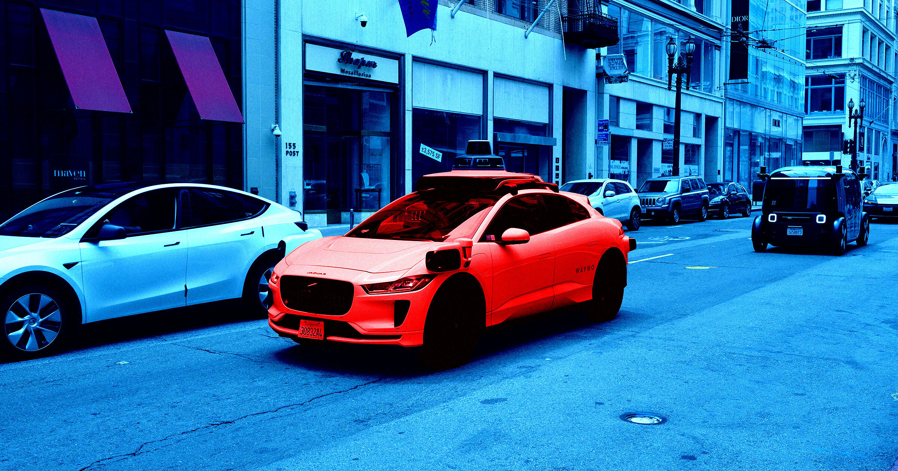

# 记者惊魂：Waymo 闯入总统车队路线

> 记者 Joe Miller 在达拉斯坐上 Waymo，10 分钟后就发现自己正堵在为本国总统清空的道路上；警察让它往右，它放着轻柔爵士乐纹丝不动，直到特勤局特工隔着车窗咆哮"这车再不走就会被碾碎"。

面对临时交通管制，自动驾驶汽车 Waymo 僵在原地，成了整条路上唯一剩下的民用车。

## "我可能在挡美国总统的道"

Waymo 的无人出租车事故率远低于人类司机——按公司自己公布的数据确实如此。但这不代表它们是毫无瑕疵的驾驶员。恰恰相反，它们极不擅长临场应变。

财经记者 Joe Miller 在《金融时报》上回忆了这样一幕：他那辆 Waymo 闯进了为总统车队清空的道路，原因是它听不懂焦头烂额的警察给的指挥。

"坐进无人驾驶车的第一趟，才 10 分钟我就意识到，我的车可能正在挡美国总统的道。"Miller 写道。

他当时住在达拉斯。Waymo 从去年起就在这里测试车辆，最近才向公众开放叫车服务。赶着去参加共和党中期大会的 Miller 随手叫了一辆自驾车。一路顺利，直到车在一个路口停下——那里警察正在疏导车流——"我的自动驾驶司机却拒绝服从"。

## 警察喊话、客服失联、爵士乐照放

Miller 记下的现场相当荒诞。"'告诉这辆 Waymo，它得往右走。'站在我车前的警察吼道。我不确定能对谁、对什么转达这个指令，只得在车里怯生生地把话喊了一遍。没有回应。Waymo 继续放着轻柔的爵士乐，对我的请求无动于衷。"

他按下车里的"呼叫客服"按钮，本以为会立刻有人接，结果只能干等。警察聚在一起商量怎么办，"每一秒都更恼火一点"，最后整条路上只剩 Waymo 这一辆民用车。也就在那时 Miller 才反应过来，警察为什么这么紧张：特朗普总统，或是他内阁里的某位成员，即将抵达共和党大会会场。

话音刚落，一名特勤局特工出现了。

Miller 写道："'我需要这辆车立刻离开这里，否则它会被碾碎，'这名特工隔着关闭的车窗咆哮，强烈暗示这件事某种程度上是我的错。"

## 最后是乘客自己下车走人

直到 Waymo 的客服人员终于接听，给出的建议是让周围所有人退到离车十英尺外——对一群正在执行总统安保的人来说，这要求近乎荒唐——自然没能奏效。Miller 干脆下车走人。回头再看，那辆无人出租车"终于打着双闪，开始一点点往前挪"。

Waymo 事后为这起事件道歉，解释说车辆软件似乎读懂了警察疏导车辆的手势，但因为该操作需要横跨多条车道，它便僵在原地——程序规定这种情况要等待远程协助。

这类事故对 Waymo 而言早已不是第一次。它的车被拍到过逆行、开上轻轨轨道、冲进警察对峙现场和拉着封锁线的犯罪现场。Waymo 一位发言人把这些问题称为需要"持续完善"的坑，并表示"在这些情况更常见的环境中运营之前，我们会继续改进"。

但搞砸政府车队，容错空间要小得多，被原谅的可能性也低得多。Miller 特别提到，Waymo 很快要进军华盛顿特区——在那里，"为路过的贵宾临时改道确实'更常见'"。

他写道："在把车部署到这里之前，公司或许该考虑先调好它们应对车队的能力。"
