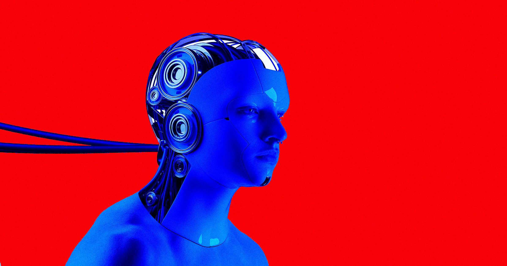

# AP 写作手册说 AI 不会思考，AI 圈集体炸锅

> 美联社写作手册（AP Stylebook）在 X 上明确表态：AI 系统不会思考、感受、欲望或理解，提醒记者避免拟人化用语。这一句话让一批 AI 专家和拥趸集体破防。

一句关于"拟人化"的写作规范，成了 AI 圈最新的情绪引爆点。

## 手册只说了一句话

在 AI 安全与意识问题吵得最凶的时候，AP Stylebook 周三在 X 上发文重申立场："人工智能系统不会思考、感受、欲望或理解。避免使用赋予它们人类特征的措辞。"它随后解释："当我们把人类的特质、情感或行为归到非人类事物上，比如动物或无生命物体，这被称为拟人化。"

这番表态在 AI 专家和信众中并不受欢迎。他们的神经被这句话集体击中，有人直接把它定性为"彻底疯了"的宣示。"我不确定一本'写作手册'应该做出如此自信的形而上学断言。"Anthropic 技术人员 Alan Rozenshtein 愤怒地写道。

## 拿擎天柱来反将一军

Google DeepMind 的哲学家、AI 伦理学者 Henry Shevlin 认为 AP 是双重标准：它在影评里对《变形金刚》中那个有感知能力的虚构机器人擎天柱大搞拟人化。"一篇 AP 影评可以告诉我们擎天柱会哀悼、会爱，但读者却需要被保护起来、不能看到'这台电脑理解了'。"他写道，"我们日常都在使用心理化的语言，并不代表字面上的承诺。你本会希望一本风格指南能区分'使用某个说法'和'相信某件事'。"

OpenAI 战略未来负责人 Dean Ball 同样愤愤不平。"AI 显然会思考、会理解。"他断言，"如果你的'思考'定义把那些能自主解决千禧年大奖难题的实体排除在外，那有缺陷的是你的定义。"他指的是 OpenAI 的模型解出某道著名数学难题的说法——这一说法本身也充满争议。他还补了一句："这种回避拟人化语言的欲望已经成了一种病。"

## 谁更需要被提醒

哲学家和科学家之间确实存在关于 AI 模型是否会思考、是否有感受的争论，但即便如此，说"存在争论"大约也已经给了"AI 已有意识"那一派过多的信任——目前并没有共识认为 AI 系统具备这些体验。

仅仅指出大语言模型不会思考、更不会像人那样思考，就足以招来愤怒，这本身就说明 AI 拥趸变得多么防备，甚至接近于一种信仰。退一步说，即便承认 AI 有可能已经在体验类似人类的情绪，为什么不索性选择更谨慎的措辞，避免先入为主地把它们当作已经活着的存在——尤其当有一整个万亿美元规模的产业，正努力推销自己的技术是一种足以改变我们生活的强大力量时。
