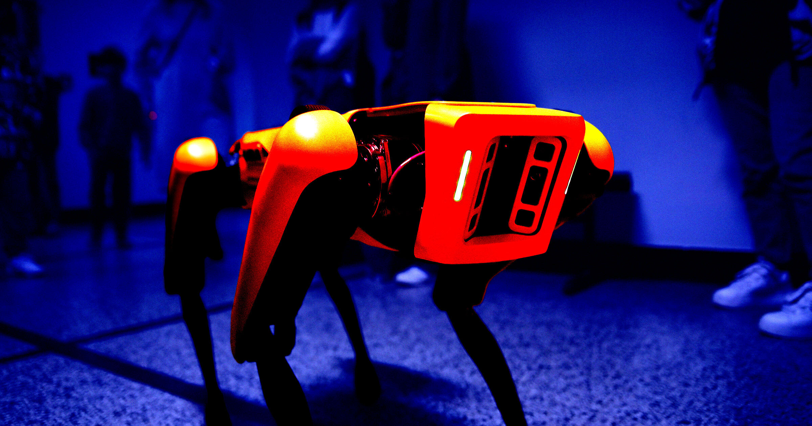

# 刚下完电击手套的大单，ICE 又开始买机器狗

> 美国移民和海关执法局（ICE）计划最多花费 200 万美元，向波士顿动力采购一批 SPOT 机器狗，配备伸缩臂和 360 度摄像头。此前，该机构刚被曝出想采购价值 2000 万美元的电击手套。

机器狗正在成为移民执法装备清单上的新条目。

## 200 万美元，够买 16 只机器狗

今年早些时候就有广泛报道称，美国移民和海关执法局（ICE）正试图拿到价值 2000 万美元的电击手套——这种"服从性装置"用途一如其名：电击任何挡路的人。

如今，ICE 似乎还想为这份反乌托邦装备清单再加一件：集成 AI 的机器狗。据 ABC 新闻查看的一份联邦采购通告，ICE 计划最多花费 200 万美元，向波士顿动力采购若干台 SPOT 机器人。文件称，这些配备伸缩臂和 360 度摄像头的机械犬，将用于"支持公共安全和执法行动，在可能对人员构成风险的环境中提供远程操作的检查、态势感知和危险评估能力"。

一台带伸缩臂的 SPOT 单价约 12 万美元，按 ICE 的预算，总共只能买到 16 只机器狗。这对尝试新技术的联邦机构来说是常态——先小批量试水，用来检验某件"玩具"的长期可行性。

## 执法工具，也是宣传素材

对 ICE 来说，这些机器狗还可能成为新一轮宣传的核心道具。自 Donald Trump 重返白宫以来，该机构的宣传攻势出现了极其阴暗的转向：对平民公开施暴的突袭行动被拍摄下来，剪辑成竖屏视频内容。

技术在这场宣传中扮演关键角色。国土安全部分享的一段快剪宣传片里，高科技警用装备与 ICE 的执法画面交错闪现：无人机击碎车窗、船上难民的空拍影像、一个 AI 目标锁定的平视显示界面，以及一闪而过的、正在上楼的机器狗。

这样一来，ICE 的高科技监控装备实际上承担了双重用途：先是用来对移民社群实施暴力突袭的工具，然后成为特朗普政府内容工厂里吸睛的素材。装备清单每延长一行，这两种用途也就同时被续写一笔。
