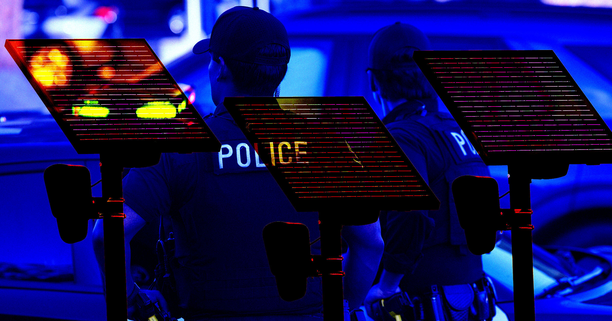

# 又五名警察因滥用 Flock 监控摄像头被起诉，这类丑闻已多到数不清

> 美国印第安纳波利斯五名警察因滥用 AI 车牌识别摄像头被起诉，其中一名 18 年警龄的老警察用 300 台 Flock 摄像头跟踪多名女性，包括他的前妻；而全美此类滥权案件已至少记录到 244 起。

Flock 在全美部署的车牌识别摄像头网络已超过 14 万台，警察滥权事件随之激增。

## 五个警察，只是最新的冰山一角

上周三，刚解封的法庭文件显示，印第安纳波利斯五名警察因滥用该局的自动车牌识别系统（ALPR）被起诉。据 ABC News 报道，其中一名被告是 18 年警龄的资深警察 Jonathan Schultz，他利用 Flock 公司提供的 300 台摄像头跟踪多名女性，其中包括他的前妻，以及一名他 2023 年在健身课上认识的女性。

十小时车程之外的北卡罗来纳州，富兰克林县治安官办公室已中止与 Flock 的合作，并解雇了一名资深警探——此人被查出用摄像头「追踪某一普通公民的一举一动」。而在加州圣何塞，一名警察因把 Flock 数据分享给他被控家暴的表亲而被开除，市府官员正呼吁收紧警察对 ALPR 的访问权限。

这些只是涉及警察滥用 ALPR 的最新事件，几乎可以肯定，未来几天到几周里还会有新的丑闻盖过它们。

## 244 起只是「被抓到的」

随着 Flock 的监控网络在全美膨胀到远超 14 万台 ALPR，警察滥权事件也接踵而至。智库 Institute for Justice 已记录到至少 244 起独立的警察滥权案件，而这还只是被抓包的部分。

这远不是几颗「烂苹果」的问题。ALPR 滥权在全美的发生频率和分布范围，指向一个真正系统性的顽疾，而且它并没有停止的迹象。

警察滥用 Flock 的手段堪称五花八门：有人用 ALPR 跟踪心仪对象、打击批评者、替移民执法人员做未经授权的查询、监视活动人士、骚扰同事、帮家暴嫌疑人定位受害者、监视开车前往清真寺的穆斯林，甚至只是无聊时拿来打发时间。

## 「以前系统没这么互联」

8 月晚些时候，芝加哥地区有 10 名警察在不同场合被查出滥用 ALPR。电子前沿基金会（EFF）高级调查研究员 Beryl Lipton 在受访时说，ALPR 几乎从一诞生就存在被滥用的问题。

她指出，过去的系统不像现在这样高度互联，而 Flock 这张相互连通的庞杂摄像头网络，让滥权真正实现了跨州、大规模的运作。

面对把怒火指向设备供应商的众多抗议者，有一点值得记住：造成 Flock 现实危害的责任人，是那些把无辜市民当成猎物来追踪的不肖警察。
