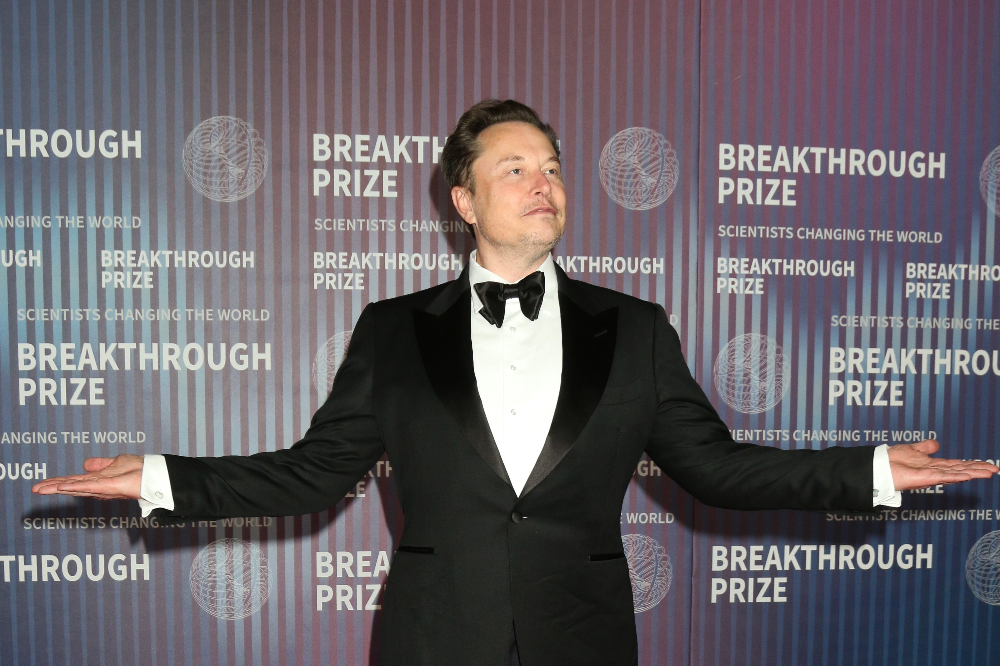

# 各大社交平台集体拒投马斯克纪录片的广告

> YouTube、TikTok、Instagram、Facebook 连同马斯克自家的 X，集体拒绝为纪录片《Musk》投放付费广告，发行方 Bleecker Street 被打了个措手不及，各平台给出的理由大多指向"政治内容"。

一部关于马斯克的纪录片即将上映，却在主流社交平台上连广告位都买不到。

## 所有大门几乎同时关上

据 The Hollywood Reporter 报道，YouTube、TikTok、Instagram 和 Facebook 都不愿接下这部影片的付费广告，而由马斯克本人拥有的 X 自然也不例外。这场集体"关闸"让发行方 Bleecker Street 大感意外，公司一时间忙着弄清楚，为什么自己的广告会被如此大面积地拒之门外。

YouTube、TikTok，以及拥有 Facebook 和 Instagram 的 Meta，都向发行方给出了与"政治内容"相关的理由。这个说法经不起推敲：TikTok 和 Facebook 的政策确实不允许政治广告，但这部纪录片和它的预告片都不属于任何政治竞选活动。对 YouTube 而言，理由更显牵强——它根本没有禁止政治广告的规定。如果正在发生的这一幕属实，即整个科技行业在为自己人抱团，那既是对马斯克影响力的惊人注脚，也构成对言论自由的一道不祥威胁。

影片需要靠广告触达观众。当主要社交平台能够联手把批评业内人物的作品"冻"在场外，结果不只是看到这类批评的人变少，制作这类作品的商业可行性本身也会被摧毁。

## 一部近四小时的"黑稿"

这部片长近四小时的纪录片名为《Musk》，以批判视角完整梳理这位亿万富翁的一生：从他在南非的成长，到作为科技创业者的成功，再到崛起为一位极具争议的政治人物。

早在 2023 年影片首次公布时，马斯克就对其开火，称它是"黑稿"——尽管当时外界几乎还没有关于影片的任何细节。过去一个月里，他进一步升级攻击，骂导演 Alex Gibney"下作"，指责他"极度偏颇"。

他还通过律师 Alex Spiro 威胁以诽谤罪起诉 Gibney 的制作公司 Jigsaw Productions。这一指控的核心，是影片据说宣扬了一个已经被辟谣的阴谋论：马斯克动用自己的 Starlink 卫星，帮助 Donald Trump 在 2024 年总统大选中获取选票。

Bleecker Street 已就预告片广告被拒一事向各平台提出申诉。YouTube 和 TikTok 仍在考虑，而 Meta 已经驳回。

## 让批评者闭嘴是老手艺

马斯克在让批评者噤声这件事上记录在案。接管 X（前身 Twitter）之后，他以牵强的理由封禁了批评他的记者；他也时常动用封口费，只为不让关于自己的坏话被说出口。

这次的不同之处在于，发声的不再只是他名下的平台。当广告投放这个看似技术性的环节成为一道可开可关的阀门，谁在决定公众能看到什么，答案比一部纪录片能不能排上片更值得琢磨。
