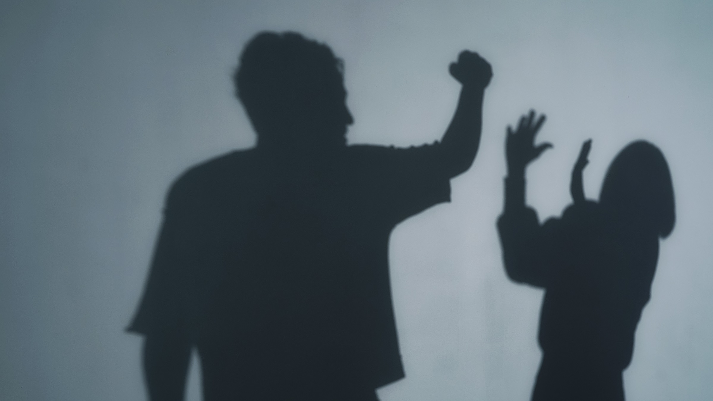

# 硅谷流传一份私下名单，列出一百多名涉嫌性侵的男性

> 据《纽约邮报》报道，硅谷科技圈正在私下流传一份表格，列出了业内"一百多名"被指控为性侵犯的男性，其中不乏知名投资人和商界人士。

一份只在私域流传的名单，成了硅谷女性之间相互示警的方式。

## 一份不公开的"耳语网络"

名单并不对外公开。据《纽约邮报》的消息源称，上面写着"知名投资人和商人"的名字，用途是提醒他人。除了姓名，名单还记录了被指控的行为细节，包括下药、性侵和强奸。由于分发极为谨慎，它很可能部分是为了保护提出指控的人。

"有些是非常响亮的名字，你懂的？那些有名的投资人。"一位在科技圈崭露头角的女性告诉《邮报》，"那些混在这个圈子里的商人，我以前在派对上见过。"另一位女性是在把自己的经历分享给别人之后，才被邀请把叙述也加进名单的——她说："我认识几位运营这个'耳语网络'的女性，里面有几百个案例。我是因为开始四处打听，才知道它存在。"

## 为什么她们不走报警这条路

消息源称，业内的女性往往不会报警，因为害怕被自己指控的人报复，进而毁掉职业前途和职业关系。"我担心的是，如果我为自己的案子去讨公道却输了，我会被城里每一个投资人拉黑。"一位女性说。

名单的流传，出现在外界重新聚焦 AI 行业那种兄弟会式文化之际。《纽约时报》近日发表调查报道，披露了多起性骚扰案件和强奸指控，源头指向"黑客之家"——那些容纳数十名有野心的年轻科技从业者同居、并时常一同派对的豪宅。

这些黑客之家以催生享乐主义生活方式著称，同时也多有业内顶尖人物站台，让住户有机会与他们结识、拓展人脉。一所知名的黑客之家 AGI House 自 2022 年以来被警方记录了 37 起事件，而其前身 Genesis 的一名成员被指控强奸和袭击。

## 转身离去的那些人

提出这项指控的 Yehong Zhu 告诉《邮报》，有房屋组织者劝她不要去报警；当被指控的袭击者跑掉时，业内很多人也拒绝帮她找出此人。Zhu 是应用 Zette 的创始人，她用一句话概括了那些拒绝帮忙或转身离去的人："我们一起投过资，一起做过生意。"

名单不会出现在公开渠道，也不会成为证据链的一环。但对身处其中的人来说，它至少说明了另一件事：在一个自诩开放、进步的行业里，安全感和信任要靠一份偷偷流传的表格来兜底。
