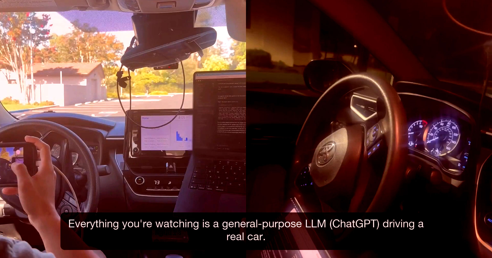

# 科学家把前沿 AI 塞进一辆卡罗拉，让它自己开

> 三名计算机科学家把 OpenAI 的 GPT-6 Astra、xAI 的 Grok 4.6 和 Anthropic 的 Claude Fable 5.1 装进一辆丰田卡罗拉，让它们跑完停车场里的一圈赛道——只有 GPT-6 Astra 成功，用时 5 分钟，全程不到 500 英尺。

把大模型直接接上方向盘，结果比预想的更粗糙。

## 停车场里的一圈赛道

经过多年开发和耗资惊人的庞大 AI 系统训练，自动驾驶汽车至今仍会被相对简单的障碍难住：它们会莫名其妙地停在高速路中间、撞穿护栏、被施工围挡搞晕，还会一头扎进洪水里。

对下注的人来说，即便最前沿的 AI 模型似乎也好不到哪去。在一个名为 DrivingBench 的新项目里，三名计算机科学家把前沿模型——包括 OpenAI 的 GPT-6 Astra、xAI 的 Grok 4.6 和 Anthropic 的 Claude Fable 5.1——装进了丰田卡罗拉的"大脑"，看看它们能否跑完停车场里设置的一圈赛道。

项目搭建本身很简单：一台联网笔记本与"comma four"设备通信，后者接入丰田的控制系统。大语言模型根据 GPS 遥测数据和从 comma four 收到的方向盘、轮胎转角等车辆状态，向笔记本发出指令。

## 只有 GPT-6 Astra 跑完了全程

结果很说明问题。只有 GPT-6 Astra 一个模型在第二次尝试时跑完了全程，用时 5 分钟——按它行驶不到 500 英尺的距离算，这速度堪称蜗牛。其他模型表现更差，绝大多数尝试连"第一个弯都没过"。

"总体而言，失败出在感知上：判断车道究竟在第一条斜向锥桶线的哪一侧。"研究者写道。Grok 在完成第一次尝试后抱怨道："车比摄像头看起来更宽。正前方不是清晰的车道，它指向花箱、墙，或者近处的红色锥桶。"

尽管如此，这是研究者在此前用上几代前沿模型多次尝试失败后，第一次让它真正跑起来。"前沿模型已经进步到能在现实中以足够低的速度驾驶真实车辆。"团队总结道，"虽然这些模型在这个基准上的成功令人震惊、令人兴奋，但这也要求我们在安全、对齐和评估上做更多紧迫的工作。"

## 不到 500 英尺，花掉 7.74 美元

在完整跑通的那一轮测试中，研究者表示他们在推理上花了 7.74 美元、消耗 660 万个 token，说明即便车速只有每小时 0.94 英里，OpenAI 的模型也要耗费大量算力来处理数据。这数字听起来不多，但考虑到车只跑了不到 500 英尺，成本累积会很快。据 The Register 的计算，对一辆油耗 25 英里/加仑、油价 4.60 美元/加仑的车来说，这笔 token 成本大约是油费本身的 500 倍。

有意思的是，一些大语言模型曾警告研究者，自己可能无法安全地驾驶这辆丰田，因此团队费了些口舌才让它们接手。"有些模型（尤其是 GPT-6 Astra）有时会以安全为由拒绝驾驶这辆实体车——哪怕是在完全空无一人的停车场，哪怕已经把所有安全措施都提示给它，包括极低的速度上限和随时准备刹车的人。"报告写道。团队还试过很多提示词改动，比如把它称作"模拟"，"但在某些试验里，它们会看到真实画面、意识到这是真的，然后开始惊慌"。

一句话：现成的前沿 AI 模型距离每天早上送你上班还很远——考虑到这么做的重大安全隐患，更别提法律问题，这大概倒是件好事。
