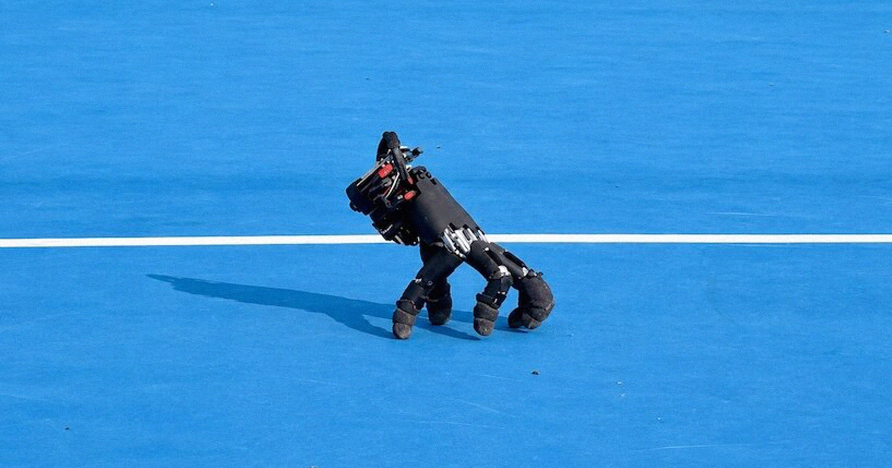

# 苏黎世联邦理工造出会走路的「断手」机器人，靠指尖敲键盘玩游戏

> 瑞士苏黎世联邦理工学院的研究团队造出一只会用指尖自己走路的拟人机器手，它能在瓷砖、草地、石头上行走，还能一边保持平衡一边敲键盘通关游戏。

苏黎世联邦理工学院软体机器人实验室的机器手能脱离手臂独立行走，在多种地面上移动。

## 一只没有身体的机器手

苏黎世联邦理工学院（ETH Zurich）软体机器人实验室的研究团队造出了一只拟人机器手，它可以完全依靠自己、用指尖在地面上行走。从公开的演示视频看，这只手灵活得超出预期：既能横跨多种不同材质的表面，又能在支撑起自身体重的同时敲击键盘。

看着它像在玩电脑游戏一样在桌上移动时，画面甚至有些可爱。但那份抽动般的步伐又带着一种蜘蛛式的诡异感，让人想起科幻恐怖片里那种身体被毁、却依然拒绝死去的杀手机器人。

## 能钻进人类手臂进不去的地方

研究人员在论文中给出了这种自主移动手的具体用途。他们写道，一只自带移动能力的机器手，可以在狭小的工作空间里作业，而不需要让原本承载它的机械臂跟着钻进去。举例来说，一台更大的机器人可以先把手放到受限开口旁的支撑面上，手再自己移动到控制开关或目标物体处完成交互，最后返回原位等待回收。

制造这种自主机器人手的难点在于：它必须用那些本来用来抓握的手指来完成走路和保持平衡。更棘手的是，为了让它更接近人手，手指长度并不一致。研究团队特意选用了一款现成的商用机器手模型，坚持不改动手指，也不改动内置的位置控制器，而是把重心放在「教」它上。

## 加装电池、电脑和传感器，用强化学习训练

当然，一些物理改造仍然不可避免。为了让它自给自足，研究人员在手内加装了电池、机载计算机和一批传感器。随后，他们在仿真环境中用强化学习训练这只手——软件只有在正确完成任务、并且大体保持手指自然姿态时才会得到奖励。

经过大量尝试，它最终学会了自己走路，并在现实世界里得到了验证。这只断手成功走过了十几种室内外表面，从瓷砖到草地再到石头，虽然都是平坦地面，但它表现出能应对不同地形摩擦力的能力。

最令人印象深刻、也最讨喜的一幕，是它被要求玩一款电脑游戏时。整段时间里它都保持平衡，逐一按下方向键，顺利通关了经典解谜游戏《推箱子》（Sokoban）。

## 会成群结队出现吗

未来会不会有一群断手在地上爬来爬去？大概率不会。但研究人员认为，这种能力可以用来增强全尺寸的人形机器人。他们在论文中写道，赋予机器手自主移动的能力，能让未来的机器人在为人类设计的空间和界面中更加游刃有余。
