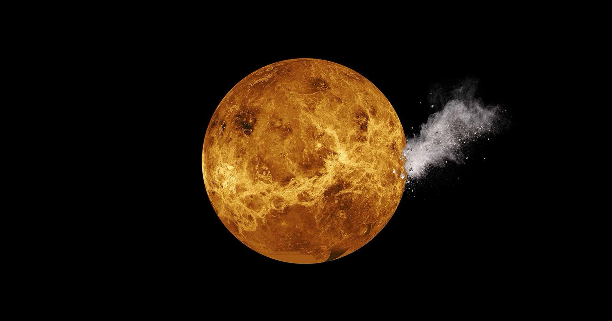

# 金星可能吞掉了自己的卫星

> 一项发表在《天体物理学杂志》上的新研究提出，金星曾经拥有自己的卫星，而这颗卫星最终向内螺旋下坠、撞上金星表面——换句话说，金星可能把自己的月亮吃掉了。

没有卫星的金星，可能在很久以前亲手毁掉了自己的月亮。

## 地球的"邪恶双胞胎"，连月亮都不同

金星常被称作地球的"邪恶双胞胎"：两者大小相近，形成于太阳系内层同一区域，还是紧邻的邻居——但正如这个绰号暗示的，与地球相比，金星对已知生命而言恶劣得可怕。

两者的相似之处可能比此前知道的更深。科学家此前推测，金星曾有一颗卫星绕其运行，最终在某个巨大天体的撞击中迎来终结。也有研究者认为，金星现在没有卫星——除了那些不直接绕行金星、因此不符合卫星定义的若干特洛伊小行星——这恰恰意味着它从未经历过那种足以抛射出足够物质、形成天然卫星的撞击。

如今，发表在《天体物理学杂志》上的一项新研究推翻了这一共识。论文作者提出，金星确实曾经拥有一颗卫星，直到它向内螺旋、以末日般的方式撞上金星表面。

## 转得太慢，卫星就留不住

说得直白一些：金星可能吞掉了自己的卫星。

"我的研究显示，金星不需要一场灾变就能走到我们今天看到的样子。"论文第一作者、加州大学河滨分校天体物理学家 Stephen Kane 在声明中说，"结果是，行星自身的引力，加上它的自转速率，让卫星自然而然地塌落到它身上。"

卫星的轨道并不总是完全稳定。我们知道月球正以每年约两英寸的速度远离地球，原因正是地球相对较快的自转。金星则相反，完成一次自转需要 243 个地球日，远超 24 小时。这种迟缓的自转意味着，假想中的卫星可能没有足够能量逃离金星的引力，注定终有一天撞上表面。

Kane 和团队用计算机模拟了这种过程，以地月之间的相互作用为参照，结果一致地显示卫星会败给金星缓慢的自转。"当我有这个发现时，我震惊了。"Kane 在声明中说，"我以为我探索的广泛情境会导向各种不同结果。但它几乎全都朝着同一个方向发展。"

## 这并不意味着金星原本就有卫星

需要说明的是，这篇论文并不必然意味着金星原本就有卫星——但如果它曾经有，那它很可能被这颗行星吞掉了。要找到过去存在卫星的直接证据极其困难：金星表面约 80% 的地貌可追溯至约十亿年前，说明它的地质记录可能在一场大规模地表重塑中被抹去。另一种可能是，曾经那颗卫星的物质深埋在金星地表之下，这需要大量研究才能查证。

更耐人寻味的是，科学家提出，那次可能形成金星卫星的大撞击，或许恰好让金星曾经宜居的表面不再适合生命，把它变成今天这个酷热而不毛的世界。与此同时，研究者仍在争论：生命繁盛究竟是否必须有卫星。

"我的感觉是，有卫星是有好处的，但宜居性并不需要它。"Kane 在声明中解释，"卫星确实改变了地球随时间的演化方式，但我们并不完全清楚这种作用有多重要。"
