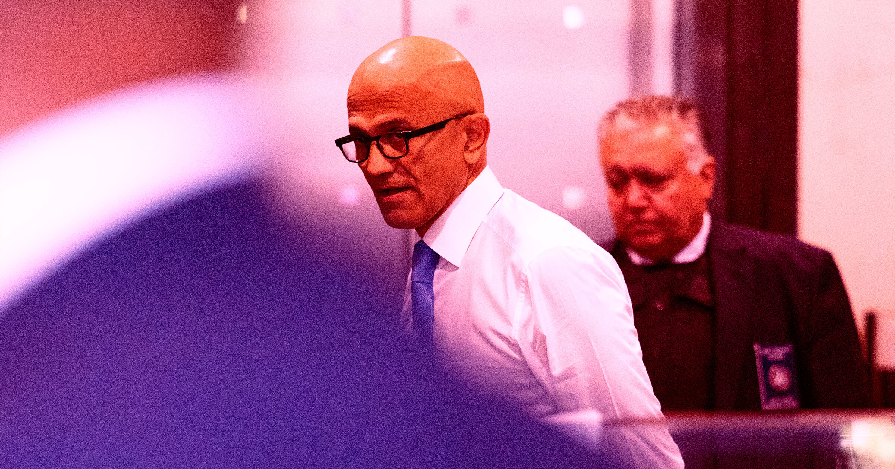

# 微软的“好邻居”数据中心承诺，被印第安纳社区组织戳穿

> 微软总裁Brad Smith曾承诺在数据中心所在城镇“投资本地非营利社区”，但印第安纳州一个由25个团体组成的联盟发现，公司派出的联络人根本不理他们的募资提案，而微软授权的捐款上限仅有100万美元，且只能给非营利组织。

微软高调宣传“社区优先的AI基础设施”，落到印第安纳州南本德，却几乎只剩空话。

## 一份听起来很暖的五点计划

今年1月，围绕 AI 数据中心的民怨不断升温之际，微软总裁 Brad Smith 发表了一篇温情脉脉的博文，谈“建设社区优先的 AI 基础设施”。

Smith 在文中列出五点计划，要与“全美各地社区结成伙伴”，行动项包括“确保我们的数据中心不会抬高你的电价”、为“你的居民创造就业”。其中一条还谈到微软计划“通过投资本地 AI 培训和公益组织来强化你的社区”。

> 我们会投资你所在社区的非营利组织。
>
> ——微软总裁 Brad Smith 在博文中写道，还特意加重了语气

他甚至描述了向数据中心落地的城镇派驻“微软联络人”的计划：“我们更广泛的贡献必须从倾听开始。你比谁都清楚，你的小镇需要什么，哪些非营利组织正在发挥作用，哪些机构最有条件做得更多。”

## 纸上很美，现实很冷

这一切听起来很美好，至少纸面上如此。但正如印第安纳州一群社区组织者所领教的，这些联络人对给微软在数据中心城镇洗白形象的兴趣，远大于真正支持本地项目。

据 Ars Technica 报道，由25个跨信仰团体、执法协会、心理健康组织等非营利机构组成的联盟 We Make Indiana，在找上门去为公司联络人募集社区服务资金后，很快撞上了微软“利他主义”的天花板。

We Make Indiana 扎根于南本德（South Bend），当地超过20%的居民生活在联邦贫困线以下——个人年收入仅15960美元，家庭为33000美元。长期以来资金短缺、提供社区医疗、公共儿童与老人照护、经济适用房和高效公共交通的政府项目，是这些人的关键生命线。眼看着微软在附近兴建900英亩的超大规模数据中心，We Make Indiana 本以为公司能搭把手。

> 这有点像是在州政府抛弃了我们之后，转头去求微软帮我们解决难题。
>
> ——圣母大学助理教授 Ryan Juskus 对 Ars 表示

## 连百万美元都要打折扣

但 Ars 报道称，公司联络人几乎对本地活动人士玩起了消失。在 We Make Indiana 找到微软当地代表，希望分得哪怕极小一部分收益——只要1%的分成，就能每年为本地项目带来3000万到4000万美元——联络人却对该提案置之不理，把理论上他们本该支持的群体晾在一边。

但正如 Ars 指出的，真正的问题远比几个畏缩的公司代表更严重。We Make Indiana 后来才了解到，微软的联络人只有权从总共100万美元的额度中做出一次性捐款，而且只能捐给非营利组织，不能给政府项目或公私合营机构。

这种缺乏兑现的态度，对本地活动人士而言无异于一记耳光。他们主张，若非政府官员同意巨额税收减免，这座造价10亿美元的数据中心所应缴纳的税款，本可以服务于南本德乃至更广地区的人民。正如 Mirror Indy 在2025年的一份分析中所指出的，这类慷慨让利造成的税收损失，全州预计高达9亿美元——而随着印第安纳州更多数据中心项目推进，这个数字现在很可能更高。

正如 Juskus 所解释的，微软授权的捐款“相对于项目规模而言，简直微不足道”。

> 在一个瞬息万变的本地和全国环境中，我们会继续组织社区和民选官员，用尽手中每一分筹码，把微软拉到谈判桌前进行真正的对话与协商。微软声称想做个好邻居，但一切都还未见分晓。
>
> ——Ryan Juskus 对 Ars 表示
