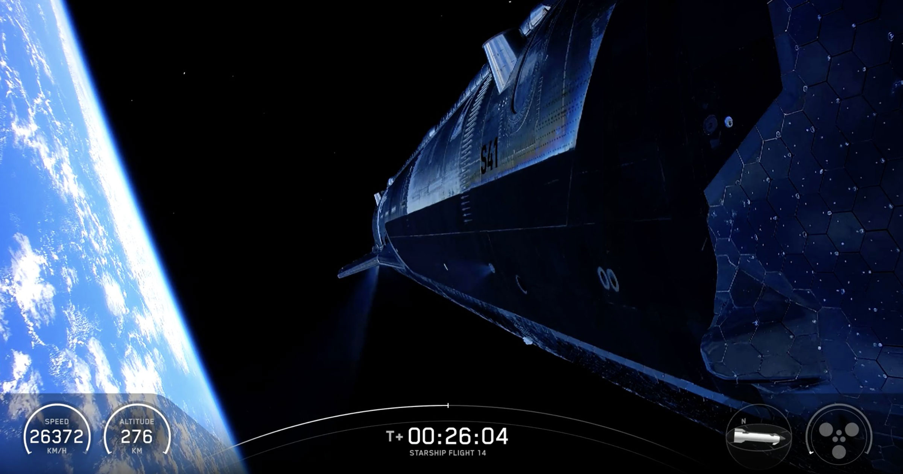

# 星舰首次入轨的高光时刻，SpaceX 股价却跌了

> 第 14 次试飞终于把星舰送进轨道，SpaceX 总部一片欢呼，但当天收盘股价反跌两个百分点，五天内累计跌约三个百分点。入轨只是通关的第一关，投资人关心的是钱和剩下的硬骨头。

星舰终于入轨了，可资本市场的反应比南德州的烟尘还要冷。

## 「星舰入轨了」

周一上午，SpaceX 第 14 次试飞的巨型星舰从南德州试验场升空，照例掀起一大团已经让人熟悉的尘土和碎屑。这台世界上最强大的火箭按计划加速冲上天际。

在达到约 171 英里高度、对地速度超过每小时 1.6 万英里后，SpaceX 的 Dan Huot 做出了正式宣布。

「星舰入轨了。」他说，SpaceX 总部爆发出热烈的欢呼。「星舰进了太空。它在轨道上。说出这句话的感觉真好。」

成功入轨标志着 SpaceX 这个野心极大的发射平台向前迈出了关键一步——此前它已经烧掉了三年时间和 13 次爆炸性的全尺寸试飞，另外还有大量在发射台上就已报废的原型机。

## 该涨的时候，它跌了

但如果你以为在这样一场被安排成「决定性胜利」的发射之后公司股价会大涨，那就想错了。

入轨之后市场开盘时股价没有跳涨，反倒到当天收盘时跌了两个百分点——与多头投资者期待的火箭式拉升相去甚远。

毕竟，围绕这个庞大发射平台的可行性仍有大量疑问，SpaceX 还必须跨过许多大坎：让超重助推器和星舰飞船都能可靠地完成回收着陆，以及在 NASA 重返月球的计划前证明它能安全运送宇航员——而这些截止日期正在快速逼近。

还有它 AI 业务的财务可行性问题，那块业务仍在烧掉巨额现金。尽管外界一直担心它能否真正盈利，SpaceX 的估值依然高得离谱——接近 2 万亿美元。

截至发稿，SpaceX 股价在过去五天下跌了约三个百分点，自六月中旬上市以来跌得更多。

## 一场惊心动魄的发射

这次发射过程并不平静。飞行约 20 分钟后，SpaceX 内部一度不确定是否要让飞船尝试入轨点火，工程师们紧张地翻查数据。一台真空版猛禽发动机失效显然让他们很不踏实，反复权衡是否继续让星舰绕地球飞六圈。

这一注押得极大。NASA 希望在 2028 年首次登月尝试之前先测试这艘飞船。成功入轨是 SpaceX 终于跨过的一大障碍，也为最早明年在地球轨道上把宇航员送进飞船铺平了路。

这次任务还释放了 26 颗星链卫星，为 SpaceX 快速扩建其宽带卫星巨型星座打开了通道。
