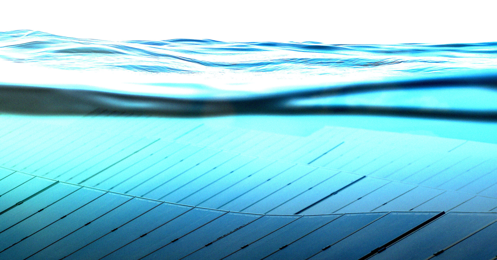

# 中国科学家让太阳能板在10米水下稳定发电，效率逼近35%

> 中国科学家在涠洲岛附近海域把太阳能板沉到海面下10米深处成功发电，创下光伏研究新纪录，转换效率最高逼近35%，甚至略微越过了长期被视为天花板的 Shockley-Queisser 极限。

研究人员用钙钛矿材料打造太阳能板，让它在水下捕捉能穿透海面的蓝绿光。

## 把太阳能板沉到海里

中国的绿色能源热潮已经把太阳能板铺到了多雨的群山斜坡上、漂浮的沿海平台上，甚至架在繁忙的高速公路上方——如今，它们连水下都能发电了。

据 EuroNews 报道，在中国西南沿海的涠洲岛附近，科学家成功在10米（近33英尺）深处利用阳光发电，创下了光伏研究领域的新纪录。

## 换掉硅，改用钙钛矿

他们的研究发表在学术期刊 Joule 上，描述的是一种用钙钛矿（一种钙钛氧化物矿物）而非硅制造的新型太阳能板。借助钙钛矿电池，研究人员得以调整面板，使其专攻那些能够穿透海面的蓝光和绿光波段。

论文称，其峰值功率转换效率——即照射到面板上的阳光有多少被转化为可用电能——最高接近35%。若属实，这一数字已与近年太阳能电池效率的突破性研究比肩，并且越过了长期存在的 Shockley-Queisser 极限，这一理论上限曾把光伏效率压制在约33%左右。

## 成绩是真的，但还很初步

需要说明的是，这些结果是在模拟条件下取得的，要确认现实环境中能否复现，还需要更严格的测试。整体测试只跑了两小时，发电324毫瓦时，仅够点亮一盏小LED灯几个小时。

但即便如此，让太阳能板在约30英尺深处逼近 Shockley-Queisser 极限，仍是一项值得记录的成就。正如 EuroNews 所观察到的，这点量级极小的电力甚至远远超出了研究人员的预期。

> 这项工作首次以实证方式验证了浸没式太阳能电池能在约10米水深实际运行，极大拓宽了它们的应用范围。
>
> ——研究作者、云南大学材料科学教授 Wen-Hua Zhang

## 离商业化还很远，但打开了想象空间

这类研究距离任何商业开发可能都还有很长的路。不过，这项研究或许能为在世界各大洋人迹罕至的水域中运行太阳能板打下基础。
