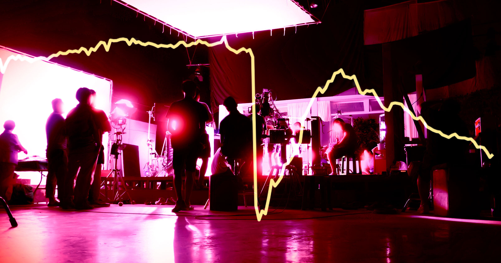

# 数据显示，生成式AI已让美国创意行业流失超20万个岗位

> 数据记者 Joseph Politano 的最新分析显示，自ChatGPT面向公众以来的四年里，美国创意行业流失了超过20万个岗位，其中近5万个就发生在过去一年，成为美国现代媒体就业史上最糟糕的一段时期之一。

从平面设计到出版、影视与录音，创意行业的就业曲线一路向下，几乎看不到拐点。

## 四年蒸发20万个岗位

如果你在创意行业或媒体工作，大概不用别人提醒，也知道情况有多糟。

但即便最贴身的一手感受，也未必能让你准备好面对这场衰退的规模。正如数据记者 Joseph Politano 在一篇新的 Substack 文章中发现的那样，过去四年里，美国“创意”行业流失了超过20万个岗位——这段时间恰好覆盖了初代 ChatGPT 面向公众开放的整个周期——其中仅去年一年就损失了近5万个。

这些数据来自美国劳工统计局（BLS）。自 Donald Trump 重返白宫以来，该机构的可信度屡遭削弱，但对于试图看懂日益黯淡就业市场的分析师而言，它仍是最稳健、最被广泛采用的关键宏观就业指标之一。

## 堪比2001和2008年的衰退

> 这构成了美国现代史上媒体就业最糟糕的一段时期之一，无论失业的强度还是持续时间，都只有2001年和2008年那两场重大经济衰退能相提并论。
>
> ——数据记者 Joseph Politano

Politano 指出，跌幅最大的是数字艺术领域，包括平面设计、广播、出版，以及电影和录音。尽管现场艺术部门中的一部分反而急剧增长——具体说是博物馆工作和表演艺术——但其他类型的现场艺术岗位，比如“受雇于独立艺术家”的就业，相比往年已经大幅跳水。

## AI正在替代，看不到尽头

总体来看，媒体与创意行业的就业增长自2023年以来一直为负，因为生成式 AI 这类工具——尽管仍旧粗糙——为设计、视频、文学和音频工作提供了唾手可得的替代方案。

在这些行业里稳定就业从来都不容易，但 AI 的崛起与整体劳动力经济的衰败，显然让它变得比以往任何时候都更难，而流失的岗位也几乎没有很快止住的迹象。
