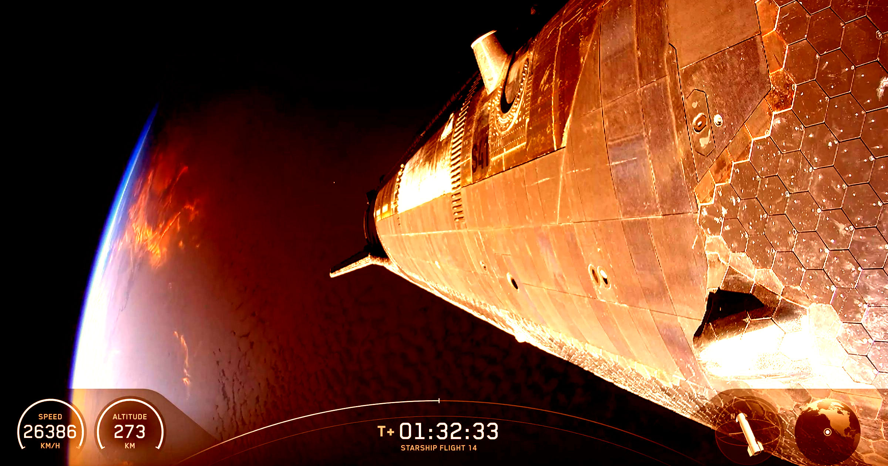

# 星舰试飞大获成功，SpaceX股价却下跌，投资者彻底看不懂了

> SpaceX的星舰第14次试飞堪称成功，火箭入轨、释放26颗V3星链卫星并安然溅落太平洋，可公司股价当天反而下跌超过2%，让投资者百思不得其解。

星舰第14次试飞升空，表现亮眼，却没能在资本市场上换来一根阳线。

## 一场几近完美的试飞

按多数人的说法，SpaceX 在周一的星舰第14次试飞可谓大获成功。

当然也有问题。一台真空版 Raptor 发动机出现故障，一度让工程师考虑提前收尾，远远达不到公司原定的绕地球六圈目标。但这枚有史以来最强大的巨型火箭还是升空了，甩开 Super Heavy 助推器，在发射约20分钟后稳定进入地球上方约171英里（约275公里）的轨道。它轻松释放了26颗 V3 星链卫星，甚至还按计划减速、调整姿态，轻柔地溅落在太平洋上。

## 股价偏偏不给面子

可投资者似乎并不买账。SpaceX 的股价周一反而下跌了超过2%，如今比一周前还要低。这种反直觉的市场反应让 SpaceX 的支持者一头雾水。

> 谁能给我解释一下，为什么股价现在比开盘还跌了超过1%？SpaceX 刚刚把星链 V3 送进了轨道，股价本该一飞冲天。
>
> ——某位困惑的投资者在 X 上发帖

“金融市场根本不懂这有多大事。”另一位投资者写道。

## 估值高得离谱，钱却在烧

诚然，星舰在 SpaceX 的成功中扮演着举足轻重的角色。CEO Elon Musk 一直把这枚火箭当作公司未来版图的基石，从大幅加速星链巨型星座的铺设，到把宇航员送上月球表面，都指望它。

但面对 SpaceX 股东的看跌情绪，周一的发射也并非全垒打。Musk 旗下社交平台 X 上的一些说法认为，这次成功早已被计入股价预期——换句话说，市场在发射发生之前就把它当成了板上钉钉的结果。

更何况，SpaceX 目前的估值接近2万亿美元，而公司每年仍亏损数十亿美元，这个数字被普遍认为严重虚高。它与 Musk 的 AI 实验室 xAI 的近期合并，更把这枚太空公司进一步推入亏损，也让这项历来被视为 Musk 最拿得出手的成就之一，蒙上了尴尬的观感。

SpaceX 虽然承诺偿还数十亿美元债务，但收入究竟从何而来仍不清楚。公司两大收入来源——出租 AI 算力和星链宽带服务——所挣的钱，仍远远抵不上其庞大开支。

此外，上周有多达3.28亿股进入可售状态，触发了一轮猛烈抛售，让股价承压。

## 发动机故障与NASA的登月计划

还有星舰挥之不去的发动机隐忧。据路透社报道，周一那台在助推器分离后意外熄火的 Raptor 发动机故障，可能危及它对接 NASA 雄心勃勃的登月任务计划。

周一的发射也只持续了三个多小时就结束，远低于最初设想的近十小时飞行时长。

总之，阻止 SpaceX 股价本周大涨的因素显然不止一个。Musk 最狂热的粉丝在为股价叫屈，把矛头指向媒体对本周试飞失误的报道，但很明显，投资者仍在继续追问一些尖锐的问题。

SpaceX 的股价在周二开盘后略有回升。但自6月中旬 IPO 以来，公司要想收复失地还有很长的路要追——上市那一刻的股价，比今天还高出将近10%。
