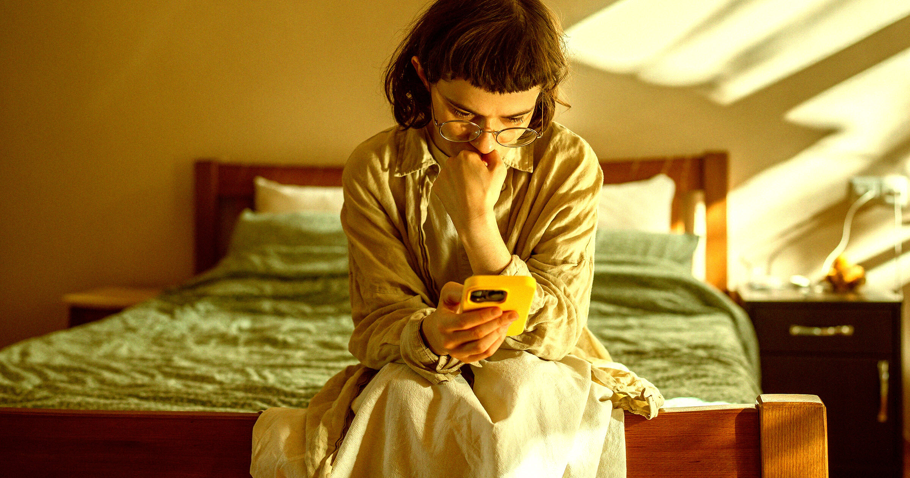

# 研究：12岁就拿到智能手机的孩子，更容易出现进食障碍

> 一项发表在 JAMA Network Open 的新研究发现，12岁前就拥有智能手机的孩子，日后出现进食障碍的比例明显更高，到14岁时有24%报告了至少一种进食障碍症状，而未拥有手机的同龄人只有16%。

一部智能手机，等于把一个充满“外貌焦虑”内容的世界塞进了孩子口袋。

## 一份让人不安的关联

新研究提示，在进入青春期之前就给孩子配智能手机，可能带来一个严峻的后果。

研究人员分析了美国现有的一项覆盖数千名儿童与青少年的调查，发现那些在12岁时就拥有智能手机的孩子，相比没有手机的孩子，更容易出现进食障碍。研究发表在期刊 JAMA Network Open 上。

抛开设备本身，这一发现再次揭示了在儿童成长的关键阶段接触社交媒体的危害。

## “手机不只是一台设备”

> 手机可以把一个充斥着外貌焦虑内容的世界，塞进年轻人的口袋。父母需要意识到，给孩子一部智能手机，关乎的不只是这台设备，它会改变孩子在数字世界里能接触到什么样的内容。
>
> ——研究第一作者、加州大学旧金山分校青少年医学专家 Jason Nagata

## 数字究竟有多悬殊

为了研究幼年拥有手机的影响，研究人员分析了一份被广泛引用的儿童认知发展调查，样本为数千名学龄儿童。其中整整70%的参与者，也就是超过6200名青少年，表示自己在12岁时就已经拥有智能手机。

在12岁的手机拥有者中，最常见的进食障碍症状是暴食，占比9%。到他们14岁时，这一群体中约24%报告了至少一种进食障碍症状。耐人寻味的是，没在童年期拿到手机的孩子里，这一比例更低——到14岁时只有16%报告了进食障碍症状。

罪魁祸首几乎可以肯定就是社交媒体。一个线索是：调查中在12岁拥有手机的孩子，把自我价值与体重挂钩的可能性是其他人的两倍；他们通过运动或自残式行为（如催吐）来抵消体重增加的可能性，也高出50%。

> 当你把自己和那些经过精心挑选、修图、加滤镜的网红比较时，很容易产生更多身材不满和自尊低落，而这又会成为进食障碍的风险因素。
>
> ——Jason Nagata 对 CNN 表示

## 哪怕推迟半年也有意义

对于熟悉智能手机和社交媒体风险的家长来说，这些发现或许并不意外。实际上，支撑这项研究的调查此前就发现，青少年的屏幕时间每增加一小时，出现进食障碍症状、把自我价值与体重挂钩的风险都更高。这项研究的新意在于，它凸显了“第一次拿到设备的年龄”所起的作用。

如果这些发现可信，那么哪怕只是稍微推迟孩子接触智能手机的时间，也可能对他们的心理健康产生实质影响。并未参与研究、来自北卡罗来纳大学的心理学与神经科学教授 Mitch Prinstein 对 CNN 表示，新兴研究显示，有效的推迟幅度可能小到六个月到一年。
