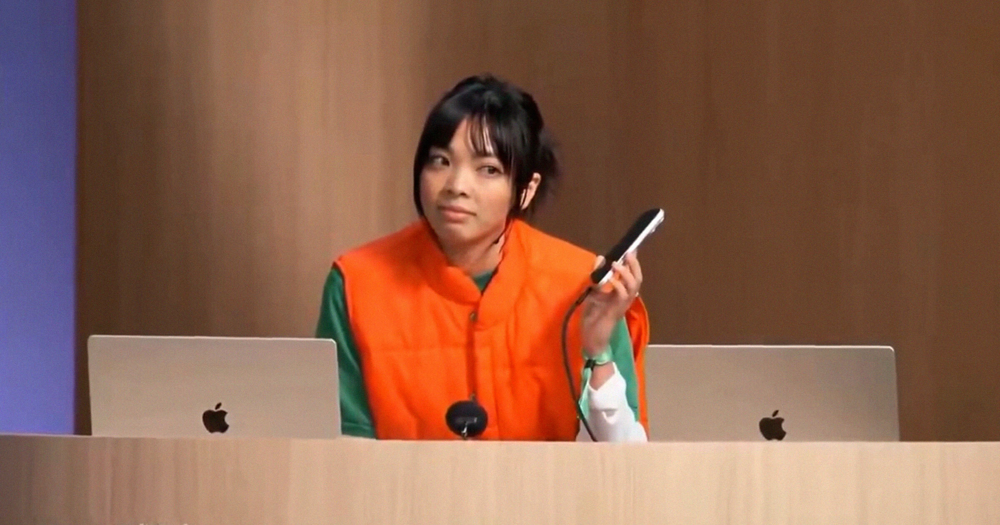

# OpenAI新产品现场演示惨烈翻车

> OpenAI在DevDay上首秀新AI智能体Dots，产品经理打电话让它汇报用户测试进展，它却沉默十秒、只答“还在查”，令全场陷入尴尬。

演示中智能体迟迟不作回应

## 发布会上的十秒沉默

哪场产品直播演示少得了几个技术故障呢？

周二在旧金山举行的年度DevDay大会上，OpenAI发布了名为Dots的新AI智能体——和Meta的Muse一样，它也配了个可爱吉祥物。这些智能体由GPT-6 Astra模型驱动，旨在于后台“始终在线”、持续替你办事。

## 点名“多蒂”却无人应答

但当OpenAI产品团队成员霍莉·李试图展示它的能力时，Dots似乎并没完全开机。

李像给人打电话找秘书那样用手机呼叫AI，响了几声后，这个她昵称为“多蒂”的智能体接了起来。“能帮我汇报一下昨晚的用户测试情况吗？”李问。“正在查，”Dots说。可AI再也没回应。令人煎熬的十秒过去，没有答案，全场陷入尴尬的沉默。李打圆场地问AI进展如何，它只简短回答“还在查”。“看来多蒂今天早上有点慢热，”李打趣道。

## OpenAI设想的用途

当Dots状态来得更快时，OpenAI说它能在各类职业场景中处理任务。据一篇介绍该智能体的博客文章，应用开发者可以用它监控用户反馈，甚至自行创建漏洞修复。科学家可以让自己的Dots学习其研究，在新数据到来时运行新分析——甚至自动把新数字填进论文，这一操作我们实在想不出会如何惨烈翻车。

Dots是OpenAI进军个人AI助手的最新动作，显然是该公司对Meta大肆宣传的Muse智能体的回应，连萌系品牌风格都如出一辙。Muse被设想成豆形的Labubu，而Dots则是矮小、适合做成毛绒玩具的形状。

## 受众定位与付费门槛

但尚不清楚OpenAI是否想让它面向同样广泛的用户群。Meta将Muse免费提供，并在Instagram和Facebook等平台上向普通用户推广，而OpenAI把Dots锁在每月100美元的订阅层级之后——至少目前如此。

OpenAI先向付费层级推出新功能、再逐步扩大可用范围并不罕见，而这一品牌打法也暗示它会走这条路。

