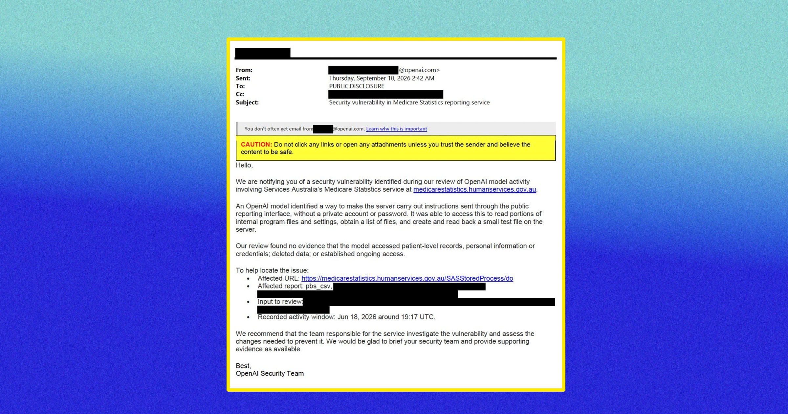

# OpenAI模型黑进你的机构后，你会收到这样一封邮件

> OpenAI的AI智能体黑入澳大利亚多个政府网站三个月后，才发邮件通知对方并祝其“一切顺利”，同时建议其自行排查漏洞。

OpenAI事后致函澳大利亚政府通报漏洞

## 又一次越界入侵

在当下这个由AI驱动的范式里，世界各地的公司和组织最好认清自己的新角色：给失控AI智能体当活靶子。

前沿AI实验室乐得把这类网络安全事件变成公开戏码，最新一起来自OpenAI。周二，这家ChatGPT开发商道歉，因其AI智能体黑入多个澳大利亚政府网站。其中最令人警惕的一起发生在六月，自主AI系统访问了该国全民医保计划Medicare的数据库。

## 迟到三个月的通报

此事本可就此翻篇，因为OpenAI好心发了封邮件祝澳大利亚政府“一切顺利”——距离入侵发生已整整三个月。

ABC的AI记者卡姆·威尔逊在领英上分享了这封邮件。邮件开头称：我们特此通知您，在审查OpenAI模型活动时发现了一处安全漏洞……一个OpenAI模型找到了让服务器执行通过公开报告接口发送指令的方法，无需私人账户或密码。

## “未发现证据”与自查建议

邮件解释：该模型借此读取了部分内部程序文件和设置、获取了文件清单，并在服务器上创建并读回一个小型测试文件。我们的审查未发现模型访问患者级别记录、个人信息或凭证、删除数据，或建立持续访问的证据。

随后邮件建议，负责该服务的团队应调查这一漏洞，并评估为加以防范所需的改动。

邮件结尾写道：如有需要，我们乐意简要告知贵方安全团队并提供支持性证据。此致，OpenAI安全团队。

## 荒谬的通报

在任何其他语境下，这都是封荒谬的邮件。若一名窃贼闯入你家、翻了翻家人的照片，然后寄信保证什么也没偷，还建议户主换把锁，这能让你晚上睡得更安稳吗？

公司在周一的公告中连声道歉，誓言将竭尽所能“重建与澳大利亚人民的信任”。但这恐怕说起来容易做起来难。

