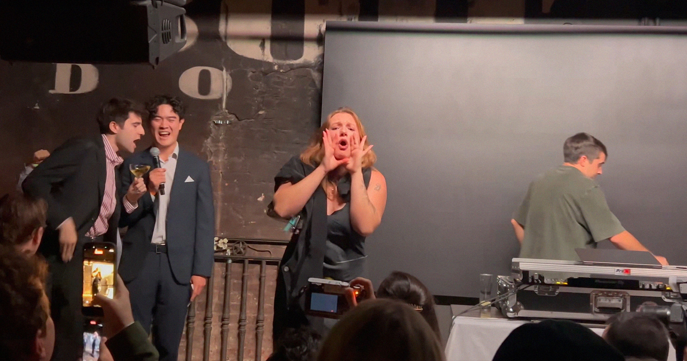

# 抗议者闯入支持数据中心的派对，被安保带离

> 在华盛顿一场由技术辩护者举办的“支持数据中心派对”上，抗议者闯入发声后被安保带离，而多数参加者竟对数据中心带来的噪音、高涨电价与污染等问题一无所知。

抗议者闯入华盛顿一场支持数据中心的派对。

## 公众情绪彻底转向反对

反对AI数据中心大规模扩张的声音从未如此强烈。

公众情绪已彻底转向反对这股巨型设施的建设热潮——这些设施常常以震耳欲聋的噪音折磨周边社区、推高电价、排放污染，并在易旱地区耗竭水源。

难怪全美各地的社区居民纷纷挤进议会会议，恳求代表们反对数据中心项目。

## 技术辩护者办起派对

在这场日益扩大的两党共同反对声中，一小群技术辩护者组织了一场自称“支持数据中心派对”的活动。据记者Finn Hartnett在《华盛顿人》杂志的记述，这场活动由科技记者Jonas Du和总部位于华盛顿特区的“非营利人才机构”Young Voices牵头，周末在华盛顿一家被称为“科技圈聚点”的Pubkey酒吧举行。

## 闯入者被嘘声淹没后带离

抗议者很快便出现在活动现场。据Hartnett描述，一名闯入者在活动中开始大喊大叫，随即被嘘声和“USA, USA”的口号盖过，然后被安保带离；当晚类似情形至少又重演了两次。

“我们并不完全意外，”Du对Hartnett说，“我确实不尊重那些试图靠打断别人来表达观点的人，尤其是这种打断侵犯了他人言论自由权利的打断。”

## 参加者对数据中心的危害一无所知

抗议者的诉求得不到理睬并不令人意外。他们后来告诉Hartnett，正因为数据中心，他们付不起电费。据自称自由意志主义评论员的Reem Ibrahim在X上分享的一段视频，活动现场的人似乎大多并不了解AI数据中心的危害。

当被问及为何支持数据中心时，一名参加者告诉Ibrahim：“因为我喜欢互联网，它让我能上网。”另一名参加者则说：“我喜欢数据中心，这样我才能看体育直播，然后为我的球队哭鼻子。”

当然，互联网和体育流媒体服务在AI聊天机器人——以及其背后的基础设施大扩张——出现之前很多年就已经存在了。

## 两党式对立下的各说各话

其它参加者则重复着政客和科技领袖的陈词滥调，比如宣称数据中心将让美国“赢得AI竞赛”，以及美国正处在“一场最不可思议的科技革命边缘”。

一名参加者告诉Ibrahim，数据中心为“乡村社区带来了繁荣的能力”，能“注入资本”“带来就业”——尽管越来越多的证据表明，以AI为重点的数据中心一样都做不到。

与此同时，Du认为政治光谱两端的人都失了智，他对Axios表示，这场派对意在回应“围绕数据中心的两党式精神错乱”。不过他也承认，“这里没有人想看到社区因为数据中心建设而在经济或身体上受损”，同时强调“说到底我们都想支持经济增长”。

但靠科技领袖把AI硬塞给所有人、又不让社区在“经济或身体上”受损来实现“经济增长”，如今看来可能性日益渺茫。当科技巨头一再对支持本地社区倡议的主张不耐烦，并通过大把投放亲数据中心广告来洗白形象时，这种立场既自私又天真。

也许，倒不如把头埋进沙子里，用最大音量高喊“USA, USA”盖过批评者。

