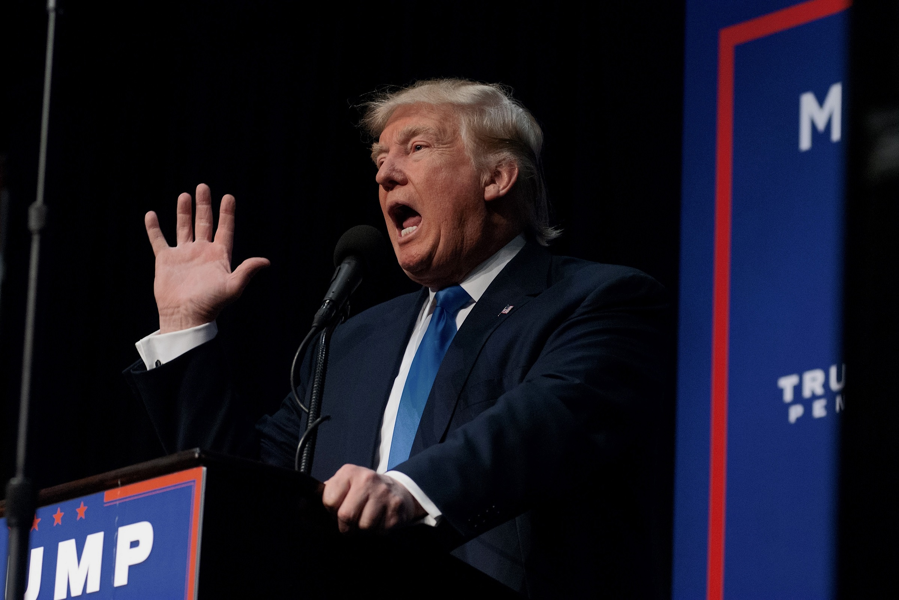

# 特朗普被追问AI问题，工作人员紧急掐断活动

> 特朗普与科技巨头会面后的记者会上，一名记者质问他为何曾称AI是“骗局”，白宫工作人员随即冲上前把媒体赶出房间并抢走转播摄像设备。

工作人员抢走转播摄像设备

## 记者追问引发现场中断

周二，美国总统唐纳德·特朗普与一批推动AI建设、最富有也最有权势的科技亿万富翁举行座谈，包括亚马逊的杰夫·贝索斯、Anthropic的达里奥·阿莫代伊和SpaceX的埃隆·马斯克。

然而，他会后接受记者围访时被打断——一名记者就他近日称任何AI安全威胁都是彻头彻尾“骗局”的言论向特朗普发难。“总统先生，你也曾称AI是个‘骗局’，为什么应该……”一名不知名记者在特朗普答问时高声喊道。

## 白宫立即清场

活动本已在收尾，但这显然不是特朗普想应对的问题。

白宫工作人员立刻跑上前，开始把媒体赶出房间，促使一名女子迅速抓起用于福克斯新闻转播信号的摄像机——尚不清楚她属于媒体还是政府方面。

## 近一年转向反监管

尚不清楚特朗普是否意识到这个问题有多尴尬。

过去一年里，这位总统在早先对AI危险表达过担忧之后，已成为AI监管反对者的终极对手——即便与他同台的许多高管，包括立场截然不同的阿莫代伊和马斯克，都因认为技术正变得过于危险而呼吁放慢脚步。（更添讽刺的是，特朗普还表态支持数据中心，而数据中心在民主党和共和党中都不受欢迎。）

## 本该深入探讨，却选择走为上

在更理智的世界里，一位有思考的民选官员或许会抓住这样一个问题，去探讨这个令许多选民深感忧虑的紧迫议题的种种微妙之处。

但在特朗普的白宫里，显然是时候溜之大吉了。

