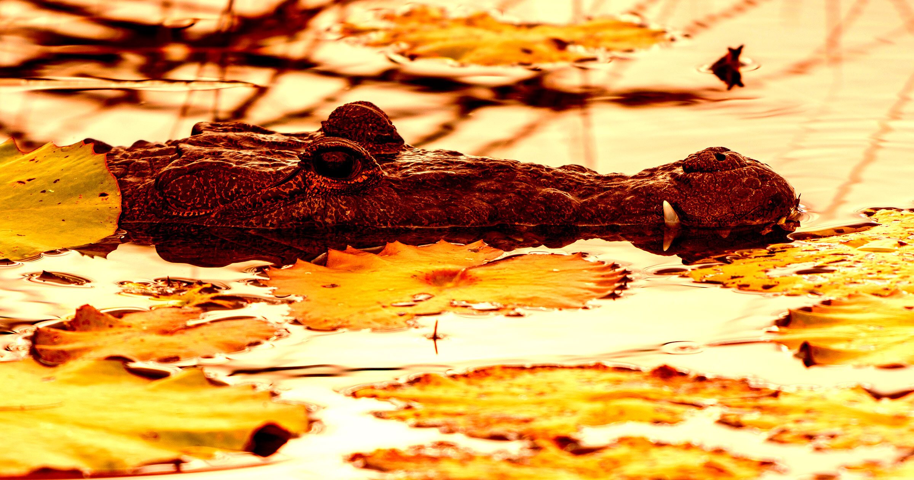

# AI假图引发恐慌，男子或面临最高三年监禁

> 一名30岁马来西亚男子用谷歌Gemini生成一张“鳄鱼出没”的假图发给同事，消息层层传开后导致新加坡最大水库关闭数日，他因此面临最高三年监禁。

一张AI生成的鳄鱼假图，让新加坡最大水库关闭数日。

## 一张AI生成的鳄鱼图

一名马来西亚男子可能在新加坡监狱度过最高三年刑期——起因是一条欠考虑的、含AI垃圾信息的短信，让这个城市国家最大的水库关闭了数日。

据BBC报道，这桩离奇事件始于30岁的Ye Lin给同事发了一张照片：一条咸水鳄潜伏在班丹蓄水池中，而这张图完全由谷歌Gemini生成。班丹蓄水池是新加坡西部住宅区一片435英亩的水域；作为对比，纽约市中心中央公园水库的面积大约只有它的四分之一，为106英亩。

## 水库被关闭，搜索行动展开

尽管具体经过不得而知，Ye的图片显然引发了一场夸张的“传话游戏”，消息最终传到了新加坡国家水务机构的官员那里。

据BBC报道，水库因此被关闭，水务机构官员与国家公园工作人员在水域中来回搜寻那条并不存在的鳄鱼。新加坡独木舟联合会、新加坡赛艇协会等以该水库为核心活动场地的团体，也在搜寻开始后暂停了运营。

## 被认定为AI垃圾信息

在仔细检视图片后，政府官员认定它不过是一点AI垃圾信息——正是那种正在全球互联网上大幅助长错误信息的产物。

随后，Ye被控“发送虚假讯息”，这在新加坡属犯罪行为，最高可判三年监禁，并可能处以约8000美元罚款。

## 两罪并罚，拟认罪

更不利的是，Ye涉嫌从手机中清除相关材料，使他看起来像是在试图销毁证据，因而被追加一项“妨碍司法公正”的指控。

据《南华早报》报道，Ye向法庭表示计划认罪。警方在一份声明中表示：“除了给公众造成恐慌和不便，此类虚假信息还导致公共资源被不必要地调动来处理这些事件。”

