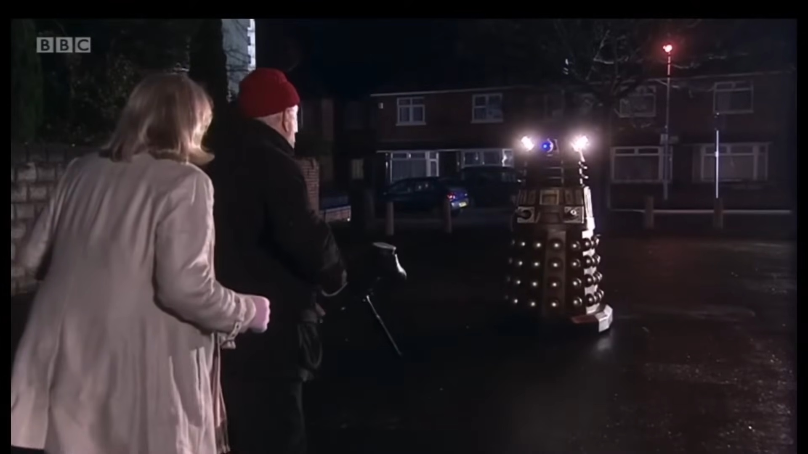

# BBC高管称在审看全AI生成的《神秘博士》，还评价“相当不错”

> BBC高管Matt Brittin在伦敦一场会议上透露，有人发给他一集50分钟、完全由AI生成的《神秘博士》，他评价“相当不错”，并畅想AI高效产出影视内容的前景。

BBC高管称一集AI生成的《神秘博士》“相当不错”。

## BBC高管的“相当不错”

收视率下滑、主演频繁更替，再没有哪段能像老派的David Tennant时代那样打动人心。《神秘博士》粉丝正处于低潮期，而AI渗入这部剧的前景，恐怕只会让情况雪上加霜。

在伦敦举行的英国皇家电视学会会议上，BBC董事Matt Brittin先是盛赞用AI批量产出影像的惊人效率，随后又提出了把它用于这家英国广播公司最受喜爱的剧集之一的可能性。

## AI能否构成一集好剧

据《Variety》报道，Brittin说：“每个人手上都有能力——或者该说六十亿人都有——以好莱坞制片厂的水准创作内容。”

他接着说：“前几天有人发给我一集50分钟、由AI生成的《神秘博士》。相当不错。我的意思是，它不会取代人类，这点我们待会儿再谈。所以现在人人都是创作者。”值得一提的是，Brittin在加入BBC之前，曾任谷歌欧洲、中东和非洲业务总裁——而谷歌正是AI技术的一大供应方。

你不得不怀疑Brittin眼中“相当不错”是什么标准。此前用AI炮制电影或短片的尝试，无一例外都产出低劣的垃圾。虽然这项技术偶尔能单独生成逼真的画面或场景，但把一堆各自为政、勉强够当屏保的图片拼凑起来，并不构成一集热门电视剧。

## 艺人的抵触情绪

电影人和其他艺术家对AI嗤之以鼻是有原因的，且不说这项技术还威胁要夺走他们的工作，而且它是在未经许可的情况下用他们的作品和表演训练的。真正使用它的人，往往被揶揄为庸才、过气者或叛徒。

## 对《神秘博士》而言的坏时机

而对于正蹒跚迈入第41季、如今因寻找新点子而停摆的《神秘博士》来说，在这个创作上的危急关口，它最不需要的就是注入一件只会无方向地回收旧创意、僵化地迎合乏味审美的工具。

## 嘴上说不取代人类，却难以掩饰

尽管Brittin坚称AI不会“取代人类”，他却几乎掩饰不住自己相信它很快就会做到。

据Deadline报道，谈及AI时他说：“并非所有创意都是糟糕的。”“在某些情况下它并不完美，但看看你能做出什么，而这在时刻变化着。”他补充道。

