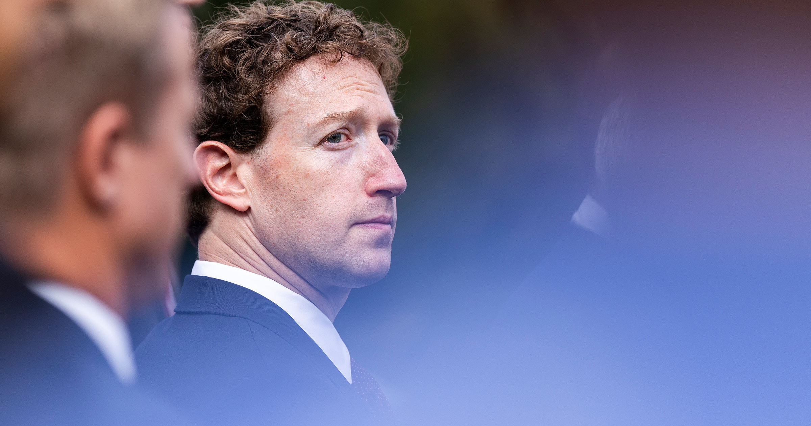

# 扎克伯格或正无意间把Meta推向“公司自杀”

> 随着高盛质疑Meta AI雄心的长期可行性，一场大规模抛售让扎克伯格的账面财富缩水近200亿美元；贝恩公司测算，若科技巨头维持当前烧钱速度，AI行业到2031年需年营收达6万亿美元才能回本。

扎克伯格加倍押注AI，投资者的耐心却可能正在耗尽。

## 加倍押注与股价波动

Meta首席执行官马克·扎克伯格做出了一个轻率的决定：加倍投入庞大的AI开支，力推一款可爱的AI吉祥物，并挖来科技业资深人士Chirantan Desai，执掌一个把Meta的AI推向企业客户的新部门。

然而，公司投资者对扎克伯格的耐心似乎正在耗尽。自上周五起，Meta股票遭遇大规模抛售，令他的账面财富缩水近200亿美元，此前高盛开始对该公司AI雄心的长期可行性提出质疑。

尽管扎克伯格的损失是暂时的——Meta股价过去一个月仍上涨逾28%——但这确实提出一个问题：究竟有多少资本会被投入以满足科技行业这套空中楼阁般的AI冲刺，以及它能否实现足以抵消投入的营收。

## 回本门槛高得离谱

除了高盛对Meta的悲观展望，整个超大规模云厂商群体在把AI变成赚钱生意上都面临着一道看似无法逾越的障碍。

据彭博社报道，大型管理咨询公司贝恩近日撰文分析认为，如果科技领袖继续沿当前烧钱的速度前行，AI行业到2031年将需要达到6万亿美元的年营收。要做到这一点，所需的将是信息时代前所未见的技术飞跃——远超智能手机等改变世界的消费科技所代表的既往创新。

## 史上最大的资本错配？

如果我们走悲观路线，假定AI行业无法完成这一奇迹，那么眼下正在加倍押注的任何大型科技公司——比如扎克伯格的Meta——实际上就是在用2020年代的大半时间为自己的公司套上绞索。

正如宾夕法尼亚大学沃顿商学院金融学教授Jessica Wachter在其对AI金融泡沫的分析中所写，如果承诺中的金钱雨“未能兑现”，那么未来的历史学家会把当下回望为“史上最大的资本错配”。

