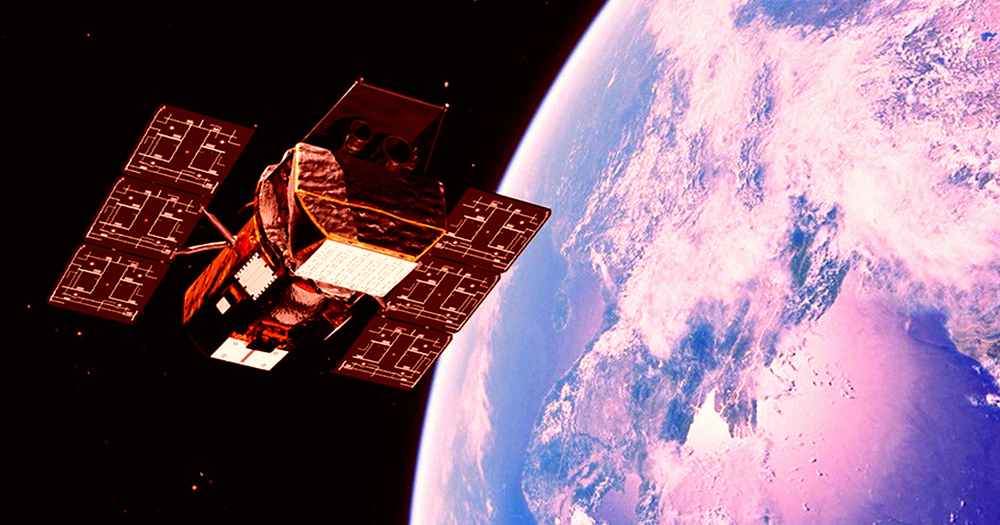

# 救援任务失败，NASA望远镜正坠向地球

> NASA七月派出的救援机器人航天器失控翻滚并在大气层烧毁，任务失败，服役逾二十年的Swift空间望远镜轨道快速衰减，预计10月中跌破185英里后被迫永久结束任务。

Swift望远镜轨道快速衰减，即将结束二十余年的任务。

## 一次雄心勃勃的救援

这是一次意图极佳的、极其大胆的任务。

今年7月，在承包商Katalyst Space Technologies的帮助下，NASA发射了一台专用机器人航天器，试图为机构日渐老化的Swift天文台提供一次急需的推动。

## 机器人失控，Swift步其后尘

但这场史无前例的救援尝试很快就螺旋式地演变成危机——而且是字面意义上。机器人开始不受控制地旋转，导致它翻滚着坠回地球、在大气层中烧毁。

如今，已经在环绕地球二十多年、为科学家提供宝贵宇宙观测的Swift，也即将遭遇相似的命运。这台空间望远镜的轨道正迅速衰减，很快将迫使NASA彻底结束任务。

根据NASA的最新通报，Swift目前在约200英里的高度绕地运行。到10月上中旬，它可能跌破185英里——低于这一阈值，“航天器运行将变得更困难，科学观测很可能停止”。

## 抓住最后的科学窗口

但这并未阻止科学家从这台天文台身上榨取每一分价值。NASA团队重新开启了三台科学仪器之一的爆发警报望远镜，该仪器此前在4月调整航天器太阳能板时不得不关闭以节省电力。

他们还允许天文台重新自动把望远镜对准新的伽马射线暴——那正是它当初设计来研究的天上极高能量闪光。不过NASA指出，“恢复科学观测让Swift重新开始快速下沉”，这对它迫在眉睫的未来并非好兆头。

## 碎片风险极低

再入大气层对这台老旧天文台而言可能致命，对其路径上的任何东西也可能如此。所幸残骸砸到人头上的风险依然极低。

空间追踪公司LeoLabs在给CNN的声明中写道：“虽然由于体积原因，Swift航天器的一些硬件可能在再入中幸存，但碎片造成重大财产损失或人身伤害的概率非常小。更可能的情况是，如同大多数在再入中幸存的碎片一样，它会落入海洋或无人居住的陆地。”

## 承包商仍望未来

NASA这场大胆却最终命运不济的救援任务，被证明是太少也太迟。但承包商Katalyst乐观地认为，未来的航天器未必注定像Swift这般走向终结。

Katalyst Space首席执行官Ghonhee Lee在官方声明中表示：“虽然我们未能完成最初设定的每一个目标，但在不到一年的时间里，我们走完了从任务构想，到发射并运营首台商业太空机器人的全过程。这是一个可以继续搭建的基础。”他补充道：“太空的未来将需要那些在抵达目的地后能做得更多的航天器。我们正朝着那个未来努力。”

