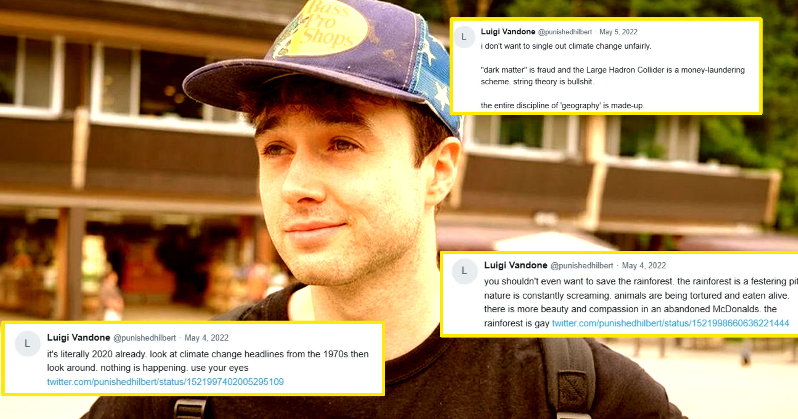

# 那位因AI风险辞职的Anthropic员工，旧推文被扒出

> 网民用网络考古扒出疑似属于Jacob Coxon的旧账号，这些旧帖一边疾呼AI可能“在本十年末杀死我们所有人”，一边却极力否认气候变化的重要性，甚至出现否认大屠杀的措辞。

疑似Coxon旧账号的推文，与其AI末日论形成反差。

## 网络侦探扒出两个旧账号

网络侦探们扒出了一些旧帖，它们似乎属于Jacob Coxon——那位以AI“可能在本十年末杀死我们所有人”的惊人说法，把AI安全运动推向高潮的前Anthropic员工。

Coxon当前的X账号@hilbertspaess创建于2026年，但侦探们发现，该平台上2021年至2024年间曾有两个使用同一用户名的更早账号。第一个账号更换过多个显示名称，但存档数据显示，它最早在2021年11月的名字似乎就是“Jacob Coxon”。把2023年创建的第二个账号与Coxon联系起来的证据较为薄弱，但其行文风格和涉及话题与第一个账号高度一致。

## 对气候变化充满怀疑

鉴于Coxon对AI所谓人类生存风险的大肆鼓吹，观察者尤其关注这些账号关于气候变化的帖子——气候变化是一项确定无疑的生存风险，不仅威胁人类，也威胁地球上所有生命，而且已被科学验证、正在发生。

但Coxon显然不这么看。该账号在2022年3月写道：“现在明明已经是2020年了。看看1970年代关于气候变化的头条，再环顾四周。什么都没发生，用你的眼睛看。”该账号声称，“担心气候变化”的人“已经丧失理智”，或许地球变暖还会有“积极后果”：“为什么非得是坏事呢？”尽管部分帖子明显带有钓鱼意味，它们仍流露出对气候变化重要性的真心怀疑。

## 带有大屠杀否认色彩的推文

该账号还写道：“你甚至不该想拯救雨林。雨林是一个溃烂的坑。大自然一直在尖叫。动物被折磨、被活活吃掉。”随后又补上一句刺人的话。

它还恳求道：“拜托别再谈‘气候变化’了。”此外，为求“完整”，它显然还影射了犹太人在大屠杀中的死亡人数——那条推文写道“六百万是一种赤裸的嘲弄”，是典型的大屠杀否认话术。

我们联系Coxon，请他就这些帖子置评并确认是否出自他本人，但未获回复。

## AI末日论引爆全球

Coxon上个月那条声称AI行业正在“拿我们的性命赌博”的帖子，爆炸式地传遍全网。他远非第一个宣称该技术可能杀死我们所有人的“吹哨人”或AI人物，但他的说法从硅谷传到国会山，在全球引起共鸣，为示警的AI安全专家提供了新的弹药。

几乎立即，Elon Musk、Dario Amodei、Sam Altman等顶级AI人物纷纷行动，宣称需要放慢AI，立法者也附和其呼吁。不久后，Amodei、Altman等AI领袖就与特朗普总统齐聚白宫，签署了一份AI安全协议。官方层面此前大概从未对气候变化展现过如此迫切。

## 公开场合淡化气候问题

在他那条帖子病毒式爆红（如今已获逾80万点赞）后不久，Coxon就登上福克斯新闻，淡化气候变化。

他对福克斯的Sean Hannity说：“我同意特朗普总统的推文，全球变暖的末日情景被夸大了。”“这是一个非常缓慢的过程。我们在谈论末日——完全荒谬。”他补充道：“过去许多其他灾难性的恐慌都只是危言耸听。这件事之所以独特，在于AI的进展快得难以置信，我们来不及在太迟之前做出反应。”

