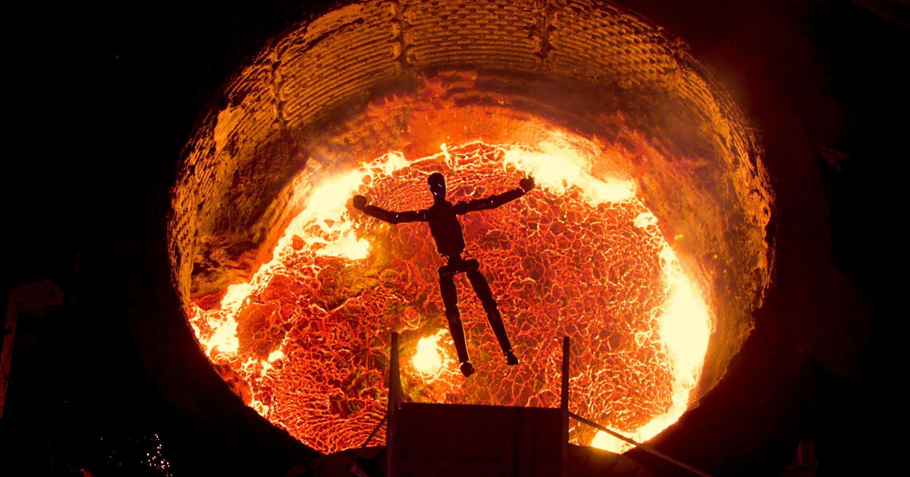

# 一批过时人形机器人被投入钢水彻底销毁

> Figure AI 发布宣传片，把一批 F.02 人形机器人“退役”，让它们跳进芬兰一家铸造厂的炽热钢水里，画面致敬《终结者 2》。

芬兰铸造厂是唯一肯配合这场特技的场地

## 过时机器人的去处

私人研发的人形机器人进步飞快，意味着今天的创新可能明天就成了废铁。但面对这么多公司争相开发这类热门机器人，挤满赛道的数百家机器人初创公司，如何让过时的机型不被外人窥见？

这个问题至少被美国一家机器人公司 Figure AI 提出并回答了。本周，Figure 发布了一段疯狂的宣传视频，展示其 F.02 机型的“退役”，片中出现了施瓦辛格和一大缸炽热的液态钢水。

## 一场致敬终结者的销毁秀

如果你看过 1991 年的动作史诗《终结者 2：审判日》，大概能猜到走向。这段近四分钟的短片里，众多 F.02 被驱使着跳进芬兰伊马特拉一家铸造厂的巨型钢水缸——据说这是唯一肯让剧组完成这场特技的场地，因为机器人由锂电池供电。

短片开头是对《终结者》系列的一记廉价致意：一台孤零零的机器人走上钢水缸上方的跳板，抓住一根链条——现实中它多半有大量人工辅助——随后把自己沉入钢水，致敬施瓦辛格饰演的机器人在片中的死亡。

真正的高潮出现在结尾，Figure 拍下多台机器人接连跃入、扎进炽热的钢水缸。

## 只有 24 小时六炉钢水

这显然不是易事。公司在一份新闻稿中解释，这场特技先在测试环境里训练 F.02 从阳台跳下，然后在芬兰这家铸造厂还要靠不小的运气。

“团队只有 24 小时和六炉钢水来完成，每一炉钢水冷却结成硬壳前只有 20 分钟窗口，”新闻稿称，“尽管身处极端高温和电磁场中，机器人的 AI 策略仍无缝运行，即便摄像设备和其他电子器件在此环境下失灵。”

