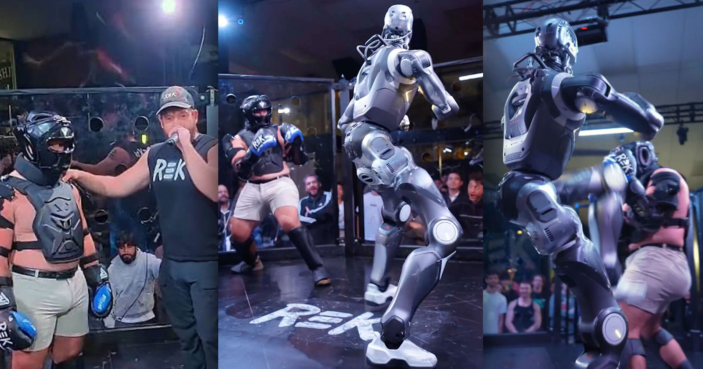

# 加州监管部门要求叫停人机笼斗

> 加州州立体育委员会向主办方发出停止令，要求立即叫停并停止宣传未获批准的人对人形机器人笼斗，否则将面临轻罪指控。

主办方晒出停止令，借势在社交媒体造势

## 一场更像 WWE 的表演

九月中旬，一家名为 Robot Entertainment Kombat 的新公司在加州举办了它自称的“史上首场人对机器人笼斗”。

但整场表演更像 WWE 而非《铁甲钢拳》：幕后机器人由人类操控员控制，出拳效果也靠对打的真人演员用摔角式的表演“卖出”。

## 监管部门发出停止令

不管真打假打，加州州立体育委员会似乎已向主办方发出停止令，抬头写着“致所有举办、推广、宣传或赞助未获批准的人对人形机器人笼斗的人士”。

据主办方晒出的信函，他们被要求立即停止举办和宣传人机笼斗，否则将面临轻罪指控。

## 真正卡点或许只是许可

体育委员会在信中似乎并非针对人机对打本身，而是主办方未取得必要许可。

但这一区分可能没有实质区别：委员会援引加州商业法规称，“未经委员会事先批准，任何（全接触格斗）赛事都不得举行”，意味着它完全可以在个案中拒批，从而否决人机笼斗，甚至无需明令禁止此类赛事。

## 创始人乐见其成

创办人 Cix Liv 把信函当成社交媒体上的造势素材，似乎对获得关注颇为满意。“兄弟们，我们成了，”他写道。

