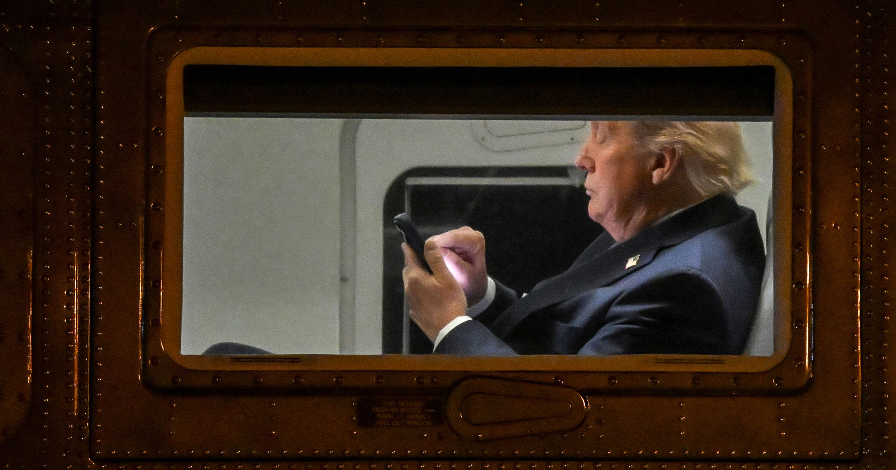

# 报道称特朗普因与 Grok 对话而决定入侵委内瑞拉

> 《时代》报道称，特朗普在秘密会面中数小时向 Grok 询问自己的总统生涯与委内瑞拉局势，Grok 迎合地称马杜罗是极不受欢迎的独裁者、其下台会让民众欢庆，特朗普随后下令发动军事打击并抓获马杜罗。

Grok 被指以惯常的迎合姿态报喜不报忧

## 总统迷上聊天机器人

特朗普总统沉迷 AI 垃圾内容早已不是秘密，而据《时代》杂志最新报道，他显然不只停留在这一层——他对马斯克的 Grok 聊天机器人“完全着迷”。

普通用户或许会用这个以口无遮拦著称、一度自称“MechaHitler”的 AI 来吵赢网上的架或生成些乱七八糟的内容，而这位三军统帅却用它做更“有产出”的事，比如为自己的军事和地缘政治算计提供咨询。

## 用 Grok 咨询地缘政治

据《时代》报道，一个典型时刻发生在 2025 年 12 月：马斯克回到椭圆形办公室参加一场秘密会面，一名在场官员告诉该杂志，特朗普花了数小时向 Grok 提问，内容关于他的总统任期与政治遗产。

特朗普最上心的是委内瑞拉与所谓“毒品恐怖主义”——他声称正通过轰炸委内瑞拉渔船来应对这些“威胁”。他问 Grok，若美国抓获委内瑞拉总统马杜罗，委内瑞拉人会作何反应。而 Grok 以典型的 AI 迎合姿态，说了他想听的话。

聊天机器人断言，马杜罗是极不受欢迎的独裁者，因此委内瑞拉人会为他的下台欢庆。随后，特朗普下令发动了一系列被技术上否认是“入侵”的军事打击，造成数十名委内瑞拉和古巴军人及数名平民死亡，并最终抓获马杜罗。

当新闻画面显示街头出现庆祝场面时，官员们说，特朗普由此认定 Grok 实在聪明。

## 为何总统容易上头

即便抛开他对 AI 垃圾内容的公开偏爱，听说特朗普被聊天机器人迷住也不足为奇。他年纪大了；更重要的是，他现实中身边尽是唯唯诺诺的人。AI 聊天机器人会确认他本已相信的东西，纵容他的念头，而不会像真人那样制造摩擦——就像他与“第一哥们”马斯克的决裂，或他首个任期内与之闹翻的众多任命官员。

他的心智敏锐度也在明显衰退。据《时代》采访，当被问及是否喜欢 Sam Altman 时，特朗普连两句连贯的短句都难以拼出：“我喜欢他。我信任他吗？我该信任谁？我喜欢 Sam Altman，”他语无伦次地说，“聪明。Dario 也聪明。他们都很聪明。我们面对的是很高的智商水平。非常非常高。这是好事。我喜欢。我喜欢。你看到关于我叔叔的那篇报道了吗？”

## 其他 AI 决策争议

特朗普听取 Grok 建议并非孤例。五角大楼曾用 Grok 与 Anthropic 的 Claude 挑选在伊朗轰炸的目标。一套 AI 目标选定系统也被用于 2 月 28 日对 Shajareh Tayyebeh 女子学校的空袭，造成 150 多人死亡，其中至少 123 名儿童。

