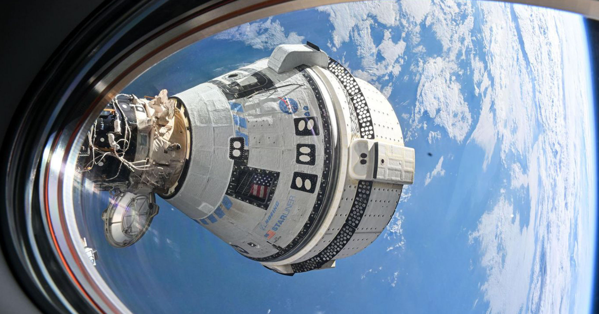

# 波音星际客机让 NASA 沦落到连进入太空都成问题

> 波音星际客机研发十多年仍未完成一次载人任务，而 SpaceX 又威胁退役载人龙飞船，NASA 被迫考虑再买两次星际客机发射，并拨款 3.59 亿美元救助波音修复推进器。

星际客机的载人首飞被推到 2028 年

## 十年都没完成的载人任务

无论怎么看，波音的星际客机飞船都堪称一场灾难。它让 NASA 花了惊人的钱，可即便研发十多年，这个太空舱仍未完成一次飞往国际空间站的载人任务。

这出屈辱的连续剧包括：一次因计算机故障而失控的无人首飞失败、一次让两名 NASA 宇航员被困空间站九个月的流产任务，以及一路不断的技术麻烦。

## SpaceX 威胁退役旧平台

但如今，由于 SpaceX 威胁要退役其载人龙飞船，NASA 可能很快不得不让这艘问题缠身的飞船“能飞也得飞，不能飞也得飞”，同时其进入太空的整体能力也受到质疑。

“SpaceX 打算在集中精力研发下一代能力星舰的同时，让猎鹰和龙这类老平台退役，我想这不是秘密，”NASA 局长 Jared Isaacman 周一对记者表示。

该机构称，正在权衡再向波音星际客机购买两次发射的方案。

## 失去载人龙之后的选择

若没有 SpaceX 那艘六年来稳定运送宇航员往返空间站的功勋飞船“载人龙”，NASA 的选项很快会所剩无几。耗资波音数十亿美元的星际客机，2024 年曾险遭彻底砍掉；但面对 SpaceX 可能放弃现有发射平台、转向庞大且尚未验证的星舰，航天局似乎已经看清了形势。

NASA 如今还得为账单兜底：该机构本周宣布，将投入 3.59 亿美元救助波音，帮它重建反应控制系统推进器——这大概是该飞船上次不幸任务中最大的麻烦源头。

在宇宙神 5 号火箭退役前，航天局还需要为联合发射联盟的火神火箭取得载人任务认证。

## 目标与尴尬的过渡期

目标是让星际客机不早于今年 12 月发射。据 Ars Technica 报道，NASA 与波音此前已有三份载人任务合同。

“我们先以一次无人星际客机一号任务飞往国际空间站，验证飞船改进并收集所需飞行数据，”Isaacman 在声明中说，“此后我们将利用所学，继续落实项目调查组确认的纠正措施，完成载人飞行所需的测试与认证。”他补充说，当前计划是让宇航员在 2028 年乘星际客机二号返回。

这是该机构一段尴尬的过渡期。国际空间站预计在十年内退役，留下进入近地轨道的巨大缺口；最终用什么替代仍不明确，多家私营公司正竞标利润丰厚的政府合同以发射自己的空间站。

若由 NASA 决定，星际客机或许会是这一愿景的一部分——但就目前所见，这远非板上钉钉。

