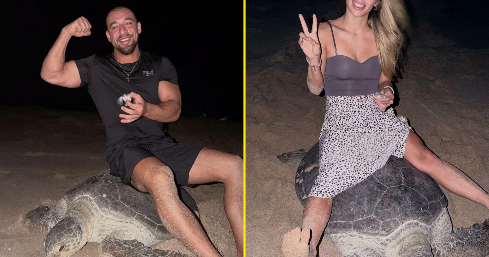

# 网红在阿曼“骑”正在产卵的海龟引众怒

> 乌克兰健身网红夫妇在阿曼哈德角海龟保护区拍下自己“骑”上一只正试图产卵的成年海龟，视频疯传后阿曼环境局称已对当事人采取法律行动。

事发地是濒危绿海龟最重要的产卵地之一

## 为流量骑上海龟

在满屏猎奇视频和 AI 垃圾内容的汪洋里，网红们为抢点击，越来越频繁地用与野生动物的惊悚“接触”把自己推上算法的顶端。

一个例证是阿曼近日疯传的一段视频：乌克兰健身网红 Vadym Oleynik 与妻子 Olena Kravchenko 拍下自己“骑”上一只正试图产卵的成年海龟。虽然不清楚他们惊扰的是哪种海龟，但事发地哈德角海龟保护区是曾属濒危的绿海龟最重要的产卵地之一。

在视频的某一片段中，Oleynik 用手指夹着一只刚破壳的幼龟，同时试图坐到那只在沙中拼命挣扎逃生的成年海龟背上。

## 视频疯传引发谴责

视频迅速在各大社交平台疯传，引来保护组织和观众的愤怒，也让 Oleynik 把自己颇受欢迎的 Instagram 账号设为私密。

“对出名和爆红的渴望，把许多人推向了邪恶而愚蠢的行为，”一名用户在 YouTube 上流传的片段下评论道，“它也暴露了一个人的本性。”

## 阿曼环境局采取法律行动

针对此事，阿曼苏丹国环境局发表声明，称正在采取行动追究 Oleynik 的责任。

“环境局一直在密切关注一段在社交媒体上流传的视频，其中一名游客在哈德角地区做出惊扰海龟的行为，违反了阿曼苏丹国保护野生动物的法律法规，”声明说。

“该局确认，已对相关个人采取必要的法律行动，”声明补充道。

## “没看到规则”的道歉

据《People》看到的回应，Oleynik 称他没有“看到”禁止坐在这种雄伟动物身上的规定。

“我首先要向阿曼苏丹国环境局道歉，”这位网红在一条 Instagram 快拍中说，“也向绿海龟保护机构道歉，因为我坐到了它身上。”

