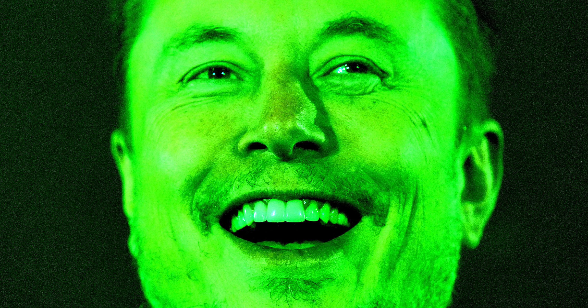

# 马斯克照搬网友关于三角洲航空WiFi的笑话

> 一位工程师调侃“给AI智能体接上三角洲航空的WiFi就能把它们隔离”，收获1.1万点赞，马斯克第二天把它改写成自己的帖子，结果被网友当场揭穿是抄来的。

马斯克照搬网友笑话，被指毫无原创性。

## 一个关于WiFi的玩笑

马斯克并不以机智著称，X平台（原推特）上近日的一件事恰好说明了原因。

几天前，机器学习工程师、Proof of Human公司联合创始人Matt Hardy在一条随手发的帖子里，调侃三角洲航空航班上糟糕的WiFi：“我们应该干脆给[AI]智能体接上三角洲航空的WiFi，把它们隔离起来。”当时科技圈正热议AI智能体逃出封闭研究环境的话题，这个应景的笑话获得了还算可观的1.1万点赞，对一条大概源于Hardy自己航班上怨气的推文而言不算差。评论区甚至有几百条留言，其中包括马斯克发的一个简单笑哭表情。

## 马斯克一天后的版本

这句话显然在这位亿万富翁脑中留下了印象。一天后，马斯克发了一条自己稍作改写的版本，还配上一句解释：“隔离AI的最佳办法就是把它送上三角洲航空的航班——它绝无可能连上互联网！”他兴致勃勃地写道。

马斯克的帖子随即爆火，收获15.5万点赞和数千条评论。

## 评论区不再全是追捧

虽然这位富豪在X上的评论区通常挤满争相讨好偶像的马斯克粉丝，这一次却带着火药味。

一位用户回复：“笑死，几乎和原帖一样好笑。”另一位揶揄道：“把别人的劳动成果说成自己的，这就是马斯克的整个职业生涯。”

## 抄来的远不止这一个笑话

对马斯克而言，这其实一以贯之。尽管坐拥巨额财富，他在幽默和生意两方面都谈不上有多少原创性。

他的公司和产品常常只是把年轻时读过的通俗科幻小说概念换了个包装：Neuralink取自Iain M. Banks所著乌托邦太空歌剧《文化》中的“神经蕾丝”，SpaceX火箭回收船的名字也源自该书；他那款臭名昭著的AI工具Grok之名，来自Robert Heinlein《异乡异客》中火星语里“理解”一词；Cybertruck则被马斯克本人形容为“《银翼杀手》会开的车”。

这种挪用远不止于翻新旧科幻概念。尽管常被奉为超级高铁的发明者，马斯克2013年关于该系统的原始白皮书其实建立在数百年的提案与概念设计之上，后来还被发现其目的并非推动一种新型交通，而是为了扼杀加州正在推进的高铁项目。

特斯拉Optimus机器人的设计同样被指剪贴自2004年威尔·史密斯主演的电影《我，机器人》，导演Alex Proyas曾因此在社交媒体上痛批马斯克。2018年，这位亿万富翁甚至因盗用一位艺术家画的独角兽而被迫删除一系列推文。

无论从哪个角度审视马斯克的商业帝国，他都清楚地把自己的成功很大程度上归功于他人的想法——无论是作为企业家，还是作为一个向成群崇拜者复读偷来的笑话的发帖者。

