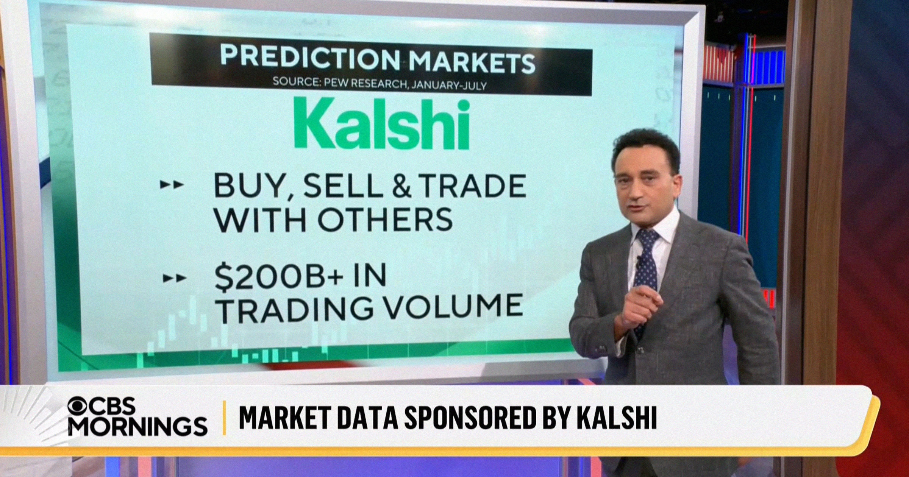

# CBS牵手预测市场公司Kalshi，把赌博当新闻播报

> CBS新闻与预测市场平台Kalshi签署合作、要把选举报道建在博彩赔率上，被批评为把赌博包装成新闻、进一步透支公众对媒体的信任。

预测市场平台上的赔率正被一些媒体当作新闻数据

## 预测市场是什么生意

Polymarket、Kalshi这类预测市场长期游走在监管真空中，早已因放任内幕交易而名声不佳——这还没算上它们在助长问题赌博方面的角色。

这些平台本质上把体育博彩公司的玩法搬了过来，让公众对几乎任何事情下注。掌握内部信息的人天然占尽优势，因此平台上的赔率与其说反映事件发生的真实概率，不如说反映哪一方投入了更多资金。

## CBS把自己接了进来

如今，在争议缠身的主编巴里·韦斯（Bari Weiss）领导下，CBS新闻成了最新一家拥抱预测市场的新闻机构。它抛开谨慎与新闻操守，与Kalshi签署合作，用来报道即将到来的选举。

这一举动凸显出在特朗普第二任期内，媒体格局已被侵蚀到何种程度。它还可能进一步削弱公众对媒体的信任，而这种信任在多年大多失实的“假新闻”指控后已跌至历史低点。

## 绕不开的尴尬问题

这项合作抛出了棘手的问题：有什么能阻止CBS的记者顺手在平台上赚一笔？把Kalshi上当前的赔率当作报道对象，本身难道不会在某种程度上扭曲结果吗？

CBS是继CNN和CNBC之后又一家达成此类数据合作的主流媒体。它们把不可信的预测当作“新闻”端给观众，同时为一场被美化的赌博正名。更糟的是，美国本就深陷赌博成瘾危机，18至49岁男性中超过一半在使用令人上瘾的在线体育博彩App。

## 有的新闻室划了红线

并非所有媒体都毫无顾虑。ProPublica、NPR、《时代》杂志和《纽约时报》等新闻机构选择划清界限，明令禁止员工就新闻事件下注。

ProPublica助理总编迭戈·索尔巴拉（Diego Sorbara）此前对The Verge说，如果你在报道伊朗的一场战争，你就不应该从中下注牟利，就像不该买相关股票一样，这是一种很自然的延伸。

